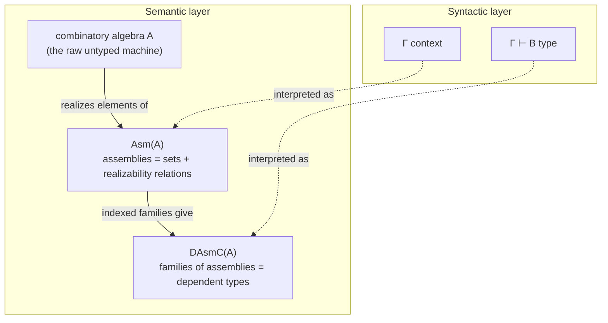
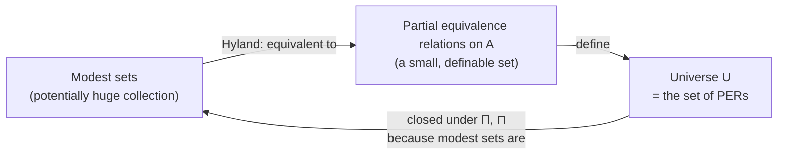

[[book-guidelines|↩ Back to guidelines]]

## Why do we need "assemblies" at all?

Suppose someone asks you to build a *model* of dependent type theory — something that tells you what a type "really is," so that when you write down typing rules on paper you can check they don't secretly let you prove `False`. The obvious first move, if you've absorbed any set theory, is: a type is a set, a term is an element of that set, a context is a tuple of sets, and $\Pi$-types are functions between them.

That move dies almost immediately once your type theory is **impredicative** — closed under quantifying over "all types," including itself. Cantor's argument (or Reynolds' famous "Polymorphism is not set-theoretic" result, which this paper cites directly) shows there is no set big enough to be "the set of all sets of terms" while still being one of the sets it quantifies over. If $U$ is impredicative and $U : U$-shaped in the relevant sense, no naive set-theoretic universe can house it.

So you need semantics that isn't just "sets and functions." **Realizability** is the classical fix, going back to Kleene: instead of asking "what is this type as a mathematical object," you ask "what does it take to *compute a witness* of this type?" A type becomes a *specification of which raw, untyped programs count as evidence for it* — and a term of that type is not an element of a set but a *promise, backed by an actual program, that a witness exists*. This sidesteps the impredicativity paradox because the "universe of specifications" doesn't have to contain itself as a set-theoretic member; it just has to be describable using the same *language* of specifications, one level down in a much more permissive sense than naive set membership.

An **assembly** is the minimal package that makes this precise for a single type.

## Assemblies: types as "sets + evidence relations"

> ▶ Definition (Assembly). An assembly over a combinatory algebra $A$ is a set $X$ together with a relation $\Vdash\ \subseteq A \times X$ such that for every $x \in X$ there exists $a \in A$ with $a \Vdash x$.

Unpack this slowly:

- $A$ is your ambient **combinatory algebra** — think of it as "the untyped programming language you're realizing types in." (See [[Combinatory-Algebra-and-Combinatory-Completeness]] for what $A$ actually looks like; you don't need the details here, just that it's some fixed set of raw "machine codes" with an application operation.)
- $X$ is the *set of abstract mathematical elements* you're trying to model as a type — e.g., if you're modeling the natural numbers, $X = \mathbb{N}$.
- $\Vdash$ ("realizes") is the bridge: $a \Vdash x$ says "the raw program $a$ is *evidence for*, or *computes*, the element $x$."
- The side condition — every $x$ has *some* realizer — says you're not allowed to include "junk" elements of $X$ that no program can ever witness. Every mathematical element must be computationally accounted for.

This is the assembly's whole trick: it lets a single mathematical object ($x \in X$) have **multiple, entirely different-looking realizers**. Two syntactically unrelated programs $a, a'$ can both realize the same $x$. That freedom is exactly what makes realizability flexible enough to model quotients, propositions-as-types, and — eventually — the impredicative universe itself.

**Rust framing.** The closest everyday analogue is a `trait` with several unrelated implementations that are nonetheless supposed to denote "the same value" at the specification level:

```rust
// X = the abstract value being specified (e.g. "the number three")
// A = anything that implements the marker trait — the "realizers"
trait Realizes<X> {
    fn witness(&self) -> X; // extract the abstract value this program stands for
}

// Two different closures can both realize the same abstract value 3:
struct AsPeanoSucc; // computes 3 by S(S(S(Z)))
struct AsRepeatedAdd; // computes 3 by 1+1+1

impl Realizes<u32> for AsPeanoSucc   { fn witness(&self) -> u32 { 3 } }
impl Realizes<u32> for AsRepeatedAdd { fn witness(&self) -> u32 { 3 } }
```

The point isn't the Rust code itself (Rust's trait system is *not* an assembly — it's fully decidable and total, whereas $A$ is an untyped, possibly-nonterminating combinatory algebra). The point is the *shape*: many implementations, one abstract meaning, connected by a "this counts as evidence for that" relation rather than by literal equality.

**What breaks without the "every element has a realizer" clause?** You'd be able to smuggle in elements of $X$ that are pure fiction from the model's point of view — mathematically postulated but computationally inaccessible. Since the entire purpose of a realizability model is to demonstrate that a type theory's *proofs correspond to programs*, an un-realized element would be a proof of something with no program behind it — exactly the gap realizability exists to rule out.

## Assembly morphisms: functions that are tracked by code

Once you have objects (assemblies), you need morphisms between them to get a category.

> ▶ Definition. Given assemblies $X, Y$, an assembly morphism $f : X \to Y$ is a function $f$ between the underlying sets, for which there exists $e \in A$ such that for every $a \in A$ with $a \Vdash x$, we have $e \cdot a \Vdash f(x)$.

In words: $f$ is a legitimate morphism only if there's a single **uniform program** $e$ that transforms *any* realizer of $x$ into a realizer of $f(x)$. This is the categorical incarnation of "computable function": $f$ isn't merely a set-theoretic function that happens to exist abstractly, it's one you can *actually run a realizer through*.

Call the resulting category $\mathrm{Asm}(A)$ — objects are assemblies over $A$, morphisms are $e$-tracked functions. The paper notes this construction works for any applicative structure with $B$ and $I$ combinators (the bare minimum needed for identity morphisms and composition to exist and be tracked).

**Lean framing (this is where Lean is more literal than Rust).** An assembly morphism is structurally the same shape as a *term* in a realizability-style dependent type theory: a function together with a *proof/program* that it respects the realization relation. If you've seen Lean's `Quotient` API, the pattern rhymes strongly with `Quotient.lift` needing a proof that a function respects the equivalence relation before it can descend to the quotient — here, $e$ is the analogous "respects $\Vdash$" witness, except the relation being respected is "is computed by," not "is equal to."

## From single types to dependent families: $D\mathrm{Asm}_C(A)$

A single assembly models one *closed* type. Dependent type theory needs **types that vary over a context** — $\Gamma \vdash B\ \mathrm{type}$ where $B$ can mention variables from $\Gamma$. The realizability model handles this with **families of assemblies**:

> An object of $D\mathrm{Asm}_C(A)$ is a pair $(X, (Y_x)_{x \in X})$: an assembly $X$ (the context) together with an assembly $Y_x$ for *every* $x \in X$ (the type, instantiated at each context element).

A morphism $(X,Y) \to (X', Y')$ is an assembly morphism $f : X \to X'$ on contexts, plus, for each $x$, a map $g_x : Y_x \to Y_{f(x)}$ — and crucially, these $g_x$'s must all be tracked by a **single, uniform** realizer $e$ (i.e. $e\, a\, b \Vdash g_x(y)$ whenever $a \Vdash x, b \Vdash y$). Uniformity here is doing real work: it's what makes substitution *computable*, not just definable pointwise.

The projection $p : D\mathrm{Asm}_C(A) \to \mathrm{Asm}(A)$ forgets the fiber and remembers only the context — this is a **Grothendieck fibration**, the categorical structure that models "type in context" abstractly (see [[Comprehension-Categories-and-Fibrations]] for the general framework this instantiates). Finally, a $\Sigma$-functor $\int : D\mathrm{Asm}_C(A) \to \mathrm{Asm}(A)^{\to}$ packages a family into its "total space" assembly $\sum_{x:X} Y_x$, giving the **comprehension category**
$$
\int : D\mathrm{Asm}_C(A) \longrightarrow \mathrm{Asm}(A)^{\to}
$$
over $\mathrm{Asm}(A)$, which the paper shows supports both $\Pi$-types and $\Sigma$-types with the fiber categories all having terminal objects — i.e., this is a genuine model of (extensional) Martin-Löf type theory (Example 4.6 in the paper).



## Adding linearity: families of *linear* assemblies

Everything above models the **cartesian** (ordinary, weakening/duplicating-allowed) side of the type theory. The paper's real target is [[Linear-Dependent-Type-Theory]], where terms may not be freely copied or discarded. To model that, assemblies over an ordinary combinatory algebra $A$ aren't enough — you need assemblies over a **linear combinatory algebra** (see [[Combinatory-Algebra-and-Combinatory-Completeness]] for what makes an LCA "linear": briefly, it has an exponential operator $!$ and combinators corresponding to the structural rules of linear logic, rather than the unrestricted $S', K'$ of a cartesian CA).

> A **family of linear assemblies** over an LCA $A$ is a pair $(X, (Y_x)_{x \in X})$ where $X \in \mathrm{Asm}(A_!)$ (a *cartesian* assembly, over the CCA $A_!$ derived from $A$ — see below) and each $Y_x \in \mathrm{Asm}(A)$ is a *linear* assembly, over $A$ itself.

Notice the asymmetry: **contexts are always cartesian**, even in a linear type theory — you're always allowed to look up a variable in $\Gamma$ as many times as you like (that's exactly why LDTT's judgement forms require types to be well-formed only in a *cartesian* context, never a mixed one — you can't have a type that consumes its indexing variable). Only the *fiber* $Y_x$, the actual linear type living over that context point, is linear.

The trick that makes both sides interact is the construction $A_!$: given an LCA $(A, \bullet, !)$, define a new application $a \bullet_! b := a \bullet\, ! b$. This turns the linear algebra into an ordinary (cartesian) one, because pre-applying $!$ to every argument recovers unrestricted duplication/discarding at the level of the *combinatory algebra*, even though $A$ itself, used with its native $\bullet$, doesn't allow that. It's the algebraic mirror of "cartesian types are the ones where every variable is implicitly wrapped in $!$."

**Rust framing.** $A_!$ is structurally close to the relationship between an affine/linear resource type and its `Rc`/`Clone`-wrapped counterpart:

```rust
// A: linear resource — using it consumes it, no Copy, no Clone
struct LinearToken(u64);

// A_bang: the "cartesian shadow" of A, obtained by wrapping every
// value in something that supports unrestricted duplication.
// This is the informal analogue of a •_! b := a • !b:
// pre-emptively "banging" every argument recovers Clone-like behavior.
#[derive(Clone)]
struct Banged<T>(std::rc::Rc<T>);

impl Banged<LinearToken> {
    fn duplicate_freely(&self) -> Self { self.clone() } // now unrestricted
}
```

The unit and monoidal product on the fiber categories of the linear side are also spelled out concretely: the monoidal unit is realized just by $I$ (the identity combinator — nothing to do, nothing consumed), and a *pair* of linear values $(y, y')$ is realized by $a = \lambda^{*}x.\, x\, b\, b'$ where $b, b'$ realize $y, y'$ respectively — i.e., "a realizer for a linear pair is a program that, when handed a continuation $x$, feeds it both components." This is a continuation-passing encoding of pairing, which should feel familiar if you've ever encoded product types via their eliminator in a total/linear setting.

## The categorical scaffolding: why "symmetric monoidal closed fibration"

The paper is precise about *what kind* of fibration the linear side must be, and it's worth understanding why each word is load-bearing:

- **Fibration** ($q : \mathrm{something} \to B$): gives you "types indexed by context," with substitution $s^{*}$ along context maps $s$.
- **Symmetric monoidal closed, fiberwise**: each fiber $q[x]$ (the linear types living over context $x$) must itself be a model of (intuitionistic) linear logic — it needs a unit, a tensor product, and linear function types, all interacting the way you'd expect ($\otimes$ symmetric, and $\multimap$ right-adjoint to $\otimes$, i.e. "closed"). This is what makes each *fiber* look like `⊗`/`⊸`-logic, independent of substitution.
- **Substitution functors $s^{*}$ are themselves symmetric monoidal closed functors**: this is the condition that guarantees the linear connectives are *stable under substitution up to isomorphism* — i.e., $(A \otimes B)[s] \cong A[s] \otimes B[s]$ syntactically. Without this, substituting into a linear type and then forming a tensor wouldn't obviously agree with tensoring first and substituting after, and the type theory's substitution lemma would fail semantically.

The realizability instance $D\mathrm{Asm}_L(A)$ is then shown (Example 4.8) to actually satisfy all of this: $q : D\mathrm{Asm}_L(A) \to \mathrm{Asm}(A_!)$ is a symmetric monoidal closed fibration, with the unit/tensor realizers described above.

## Connecting the two sides: the adjunction $L \dashv M$

A **linear comprehension category** (Definition 4.9) is the full package: a cartesian comprehension category (the $\int$-based one from Example 4.6, but instantiated at $A_!$) *plus* a symmetric-monoidal-closed fibration for the linear side, *plus* an adjunction

$$
L \dashv M
$$

between them, where $M$ (recall from [[Linear-Dependent-Type-Theory]]: the modality turning linear terms into cartesian ones) and $L$ (its left adjoint, freely turning cartesian data into linear data) are required to be a **fiberwise symmetric monoidal adjunction** and to preserve cartesian morphisms.

Concretely, in the realizability model (Example 4.11):

- $M : D\mathrm{Asm}_L(A) \to D\mathrm{Asm}_C(A_!)$ just *forgets* linearity — it sends a linear assembly $(X,Y)$ to the family $Y_x$ viewed as ordinary (cartesian) assemblies. This makes sense set-theoretically because $A$ and $A_!$ literally share the same underlying carrier set — only the application operation differs.
- $L : D\mathrm{Asm}_C(A_!) \to D\mathrm{Asm}_L(A)$ goes the other way: given a cartesian assembly $Y_x$, it builds a *new* realizability relation where $a \Vdash y$ iff $a = {!}b$ for some $b$ realizing $y$ in the original assembly. In other words, $L$ forces every realizer to be "banged" — this is the semantic mirror of the syntactic rule that says linear terms can only invoke $M$/coerce cartesian data in via $!$.

Both $M$ and $L$ turn out to be **faithful** (injective on morphisms) — this is exactly the semantic content behind the syntactic **$M$-inj** rule from Chapter 2 of the paper: injectivity of the modality corresponds to faithfulness of the functor interpreting it. If you ever wondered why the authors were confident enough to *postulate* $M$-injectivity as a sound rule rather than just an ad-hoc convenience, this is the proof obligation they discharged to justify it.

**Table 3 (syntax ↔ semantics dictionary)**, reproduced here because it's the single best summary of this whole section:

| Syntax | Linear comprehension category | Realizability model |
|---|---|---|
| Context | Object in $B$ | Assembly over $A_!$ |
| Cartesian type | Object in $E$ | Family of assemblies over $A_!$ |
| Term of cartesian type $X$ | Section of $\pi_X$ | Section of $\pi_X$ |
| Linear type | Object in $L$ | Family of assemblies over $A$ |
| Linear term | Morphism in $L$ | Morphism of linear assemblies |

The row worth dwelling on: **cartesian terms are sections** (a term of type $X$ is "a way of picking a point of $X$ over every context, compatibly with substitution" — the usual dependent-type-theory reading), but **linear terms are morphisms**, full stop — not sections of anything. This reflects that a linear term of type $B$ in mixed context $\Gamma \mid \Xi$ is really a *linear function* from (the interpretation of) $\Xi$ to $B$, consuming its linear hypotheses exactly once, rather than a "value sitting at a point."

## Type formers, briefly: dependent products, sums, and equalizers

With the fibration/adjunction machinery in place, the paper interprets the actual type formers as universal constructions — this is worth knowing in outline even though the article on [[Impredicativity-and-Impredicative-Universes]] and [[Impredicative-Encoding-of-Linear-Lists]] go deeper on how they get *used*:

- **Linear dependent products $\sqcap$** are interpreted as a *right adjoint* to substitution (Definition 4.12); concretely (Example 4.13), a realizer $a$ for an element of $\sqcap_s Y$ is a program that, given a realizer $b$ of an index $x$, computes $a\,{!}b \Vdash f(x)$ — note the forced $!$ on the argument again, since the indexing type must be cartesian.
- **Linear dependent sums $\sqsubset$** are the corresponding *left* adjoint, additionally required to satisfy **Frobenius reciprocity** — a coherence condition ensuring that "sum then tensor" and "tensor then sum" agree, which matters for the interaction between $\sqsubset$ and $\otimes$ in later proofs.
- **Equalizer types** are interpreted via plain **fibrewise limits**: a linear comprehension category supports equalizers precisely when each fiber $q[x]$ has ordinary categorical equalizers and substitution preserves them ([[Comprehension-Categories-and-Fibrations#Definition 4.14|Definition 4.14]]). Since $q[x]$ is already required to have adjoints on both sides (for $\sqcap$ and $\sqsubset$), it automatically preserves all limits and colimits — so this reduces to just checking each fiber has equalizers at all, which the realizability instance trivially does (Example 4.15).

## The payoff: modest sets, PERs, and where the impredicative universe comes from

This is the section this article has been building toward, because it's the mechanism that makes *impredicativity* — a huge, self-referential-flavored universe — possible inside a model built from mere sets and relations.

**The problem restated:** you want a type $U$ such that $\mathrm{El}_C(U)$/$\mathrm{El}_L(U)$ can decode *any* code in $U$ to an actual type, and you want $U$ itself to be closed under forming large products $\prod_{x:A} B$ even when $A$ is huge. If $U$ were modeled as literally "the assembly of all assemblies," you'd immediately be back in Russell's-paradox territory — there is no assembly of all assemblies, for the same cardinality reason there's no set of all sets.

**The resolution: not every assembly needs to be in $U$ — only the *modest* ones, up to isomorphism, and modest ones can be coded by something small.**

> ▶ Definition (Modest set). An assembly $X$ (over a BI-algebra $A$ — an applicative structure with just $B$ and $I$ combinators, the bare minimum for composition/identity) is **modest** if realizers never lie about identity: whenever $a \Vdash x$ and $a \Vdash y$ for the *same* $a$, then $x = y$.

Read this as: a modest assembly's realizers are "self-describing" — you could, in principle, recover *which* element $x$ a program computes just by knowing that it's *a* realizer, without any other bookkeeping. Assemblies that aren't modest can have one program simultaneously "count as evidence" for two genuinely different elements — a kind of computational ambiguity that ordinary (non-modest) assemblies tolerate but that makes them too large/unruly to enumerate by a small index.

> ▶ Definition (PER). A **partial equivalence relation** on $A$ is a relation that is symmetric and transitive (not necessarily reflexive — hence "partial": some elements of $A$ may be related to nothing, including not to themselves).

The magic theorem:

> ▶ **Theorem (Hyland).** For a BI-algebra $A$, the category of modest sets over $A$ is *equivalent* to the category of partial equivalence relations over $A$.

Why does a PER give you a modest set for free? Given a PER $R$, build the assembly whose *elements* are the equivalence classes of $R$ (restricted to the reflexive elements) and whose realizers are just: $a \Vdash [a]_R$. This is automatically modest, because if $a \Vdash x$ and $a \Vdash y$ then by construction $x = [a]_R = y$.

**Why this theorem is the whole ballgame:** a PER is *just a subset of $A \times A$* satisfying two easily-checked closure conditions. The **collection of all PERs on a fixed $A$ is itself a genuine, small set** — it's a subset of $\mathcal{P}(A \times A)$, no bigger than the powerset of $A \times A$. But by Hyland's theorem, this small set of PERs is rich enough to represent — up to isomorphism — *every* modest set, which is a much larger, less controlled collection. You've compressed "all the well-behaved types you'd ever want to quantify over" into a small, definable index set. That compression is precisely what lets you build a universe $U$ that quantifies over itself without paradox: $U$ doesn't literally contain all types, it contains all *PERs*, and every type you actually care about (every modest one) shows up somewhere in that list.

**Concretely, in this paper's model (Example 4.18):**

$$
U := \{\, R \mid R \text{ is a PER on } A \,\}, \qquad a \Vdash R \text{ always (trivially, for every } a\text{)}.
$$

Given a term $t : U$ (i.e., a PER $R$), decoding produces both a cartesian type $\mathrm{El}_C(t)$ and a linear type $\mathrm{El}_L(t)$ — the *same* PER gives rise to both a modest set read cartesian-style and one read linear-style, which is exactly why this paper gets away with **one** universe with **two** decodings instead of two separate universes (see [[Impredicativity-and-Impredicative-Universes]] for why that unification matters).

**Impredicativity itself follows from two facts, both stated explicitly in the paper:**

1. Every modest set is isomorphic to a PER-induced one (Hyland's theorem) — so nothing escapes being "in" $U$ up to iso.
2. Modest sets are **closed under dependent products** — both the ordinary $\prod$ and the linear $\sqcap$ — so if every $Z_y$ (for $y$ ranging over some possibly-huge modest set $Y$) is modest, then $\prod_{y:Y} Z_y$ is modest too, hence (by fact 1) isomorphic to something already coded by a PER in $U$. This is the semantic reason the syntactic rules $\widehat{\Pi}$-f / $\widehat{\sqcap}$-f (large product formation inside $U$) are *sound*: taking a large product of things in $U$ never produces something that escapes $U$.



## Where this leads

This chapter's constructions are exactly what makes [[Impredicative-Encoding-of-Linear-Lists]] possible: the encoding $\mathrm{List}^{*}(A) := \sqcap_{X:U}\, \mathrm{El}_L(X) \multimap {!}(\cdots) \multimap \mathrm{El}_L(X)$ literally quantifies over *all* $X : U$ — a large linear product over the universe. Without the modest-sets/PER argument above showing $U$ is closed under exactly this kind of large $\sqcap$, that definition wouldn't even type-check semantically; the realizability model would have no way to interpret "quantify over every type in $U$" without running into the same paradox that rules out naive set-theoretic impredicativity in the first place. The refinement of that encoding into a genuinely initial algebra, via [[Comprehension-Categories-and-Fibrations|equalizer types]], is the paper's final payoff.

**Connection to the standing goal (`type-theory` focus area).** This is the clearest available worked example of *why* a naive "types are sets" semantics fails for a dependent type theory with an impredicative/universe-polymorphic layer — precisely the situation a Lean-style elaborator's kernel has to handle when checking `Sort u` hierarchies and `Prop`-impredicativity. The modest-sets/PER trick is also a direct ancestor of how *definitional equality up to a realizer* gets modeled at all: an assembly's realizability relation $\Vdash$ is, in spirit, the semantic counterpart of what a kernel's `isDefEq`/`whnf` reduction machinery has to decide *syntactically* — "does this term compute to something that counts as evidence for that type." If you're building a trusted kernel, this section is a preview of the model-theoretic story that has to back up whatever definitional-equality algorithm you implement.
