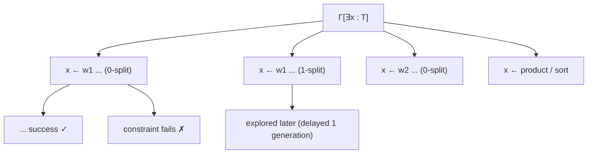

[[book-guidelines|↩ Back to guidelines]]

# Elementary Substitutions and the Search Tree

## The idea in one paragraph

To find a proof of $T$ in $\Gamma$, form the context $\Gamma[\exists x{:}T]$ and look for a substitution $\sigma$, well-typed in it, such that $\sigma(\Gamma[\exists x{:}T])$ is a **success context** (no unknowns, all constraints trivial). Build $\sigma$ one small step at a time: pick an existential variable, instantiate it by one of finitely or infinitely many "elementary" shapes, and repeat. The tree of all such choices is the **search tree**.

## Which variable to instantiate

By [[Contexts-Quantifiers-and-Constraints]] (Prop. 9), in a context that is neither success nor failure there is an existential $x$ whose type is $T=(x_1{:}P_1)\dots(x_n{:}P_n)P$ with $P$ atomic **rigid**. Rigid means its head is a universal variable, so the shape of $x$'s value is forced: $n$ abstractions, then an atom or a product/sort.

## Elementary substitutions (Def. 27)

Let the chosen $x$ have that type. For every universal variable $w$ declared to the left of $x$ (or equal to some $x_i$), with type

$$w:(y_1{:}Q_1)(y_2{:}Q_2\,y_1)\dots(y_q{:}Q_q\,y_1..y_{q-1})\,(Q\,y_1..y_q),$$

and for every $r\ge 0$ ("**$r$-splitting**"), consider

$$x\leftarrow\gamma,\ \ [x_1{:}P_1]\dots[x_n{:}P_n]\,\bigl(w\ (h_1\,\vec x)\dots(h_{q+r}\,\vec x)\bigr).$$

The context $\gamma=\varphi\,\chi_1\cdots\chi_r\,\psi$ contains:

- $\varphi$: the existentials $h_1..h_q$ for the head's declared arguments;
- $\chi_i$ for each of the $r$ **extra** applications beyond the head's $q$ declared products: existentials $H_i{:}(\vec x{:}\vec P)\,s_i$ and $K_i{:}(\vec x{:}\vec P)(z{:}H_i\,\vec x)\,s'_i$ for the domain and codomain of the *product that the partially applied head must turn out to have*, a constraint saying exactly that ($(\ldots)Q(h_1..h_q)=(\ldots)(z{:}H_1\vec x)(K_1\vec x z)$, or the chain version for $i>1$), and then $h_{q+i}:(\vec x{:}\vec P)(H_i\,\vec x)$;
- $\psi$: the final **well-typedness constraint** that the whole term has type $(\vec x{:}\vec P)P$. For $r=0$ it is $(\vec x{:}\vec P)(Q\,(h_1\vec x)..(h_q\vec x))=(\vec x{:}\vec P)P$; for $r\ge1$ it is $(\vec x{:}\vec P)(K_r\,\vec x\,(h_{q+r}\vec x))=(\vec x{:}\vec P)P$.

If $P$ is a **sort**, two more kinds of substitution exist: $x\leftarrow[\ ],\,[\vec x{:}\vec P]\,s$ for $\langle s,P\rangle\in Ax$, and the **product substitution** $x\leftarrow\gamma,\ [\vec x{:}\vec P]\,(y{:}(h\,\vec x))(k\,\vec x\,y)$ with $\gamma=[\exists h{:}(\vec x{:}\vec P)s;\ \exists k{:}(\vec x{:}\vec P)(y{:}h\,\vec x)\,s']$ for $\langle s,s',P\rangle\in R$.

The set of all of these is $\Sigma(\Gamma)$. (Props. 17–19 show each one is well-typed in Meta; see [[Meta-Type-System-and-Existential-Variables]].)

### Rust skeleton

```rust
struct Elem { var: Var, gamma: Vec<Item>, term: Term }

fn sigma(ctx: &Ctx, x: Var, max_split: usize) -> impl Iterator<Item = Elem> + '_ {
    let ty = ctx.type_of(x);                       // (x1:P1)...(xn:Pn) P, P atomic rigid
    let (binders, p) = ty.telescope();
    ctx.universals_left_of(x).chain(binders.vars()).flat_map(move |w| {
        let (q, _) = ctx.type_of(w).telescope().len_and_target();
        (0..=max_split).map(move |r| build_head_subst(ctx, x, &binders, &p, w, q, r))
    })
    // + sort substitutions, product substitutions when p is a sort
}
```

The `max_split` parameter shows the issue: the true set is infinite. Dowek instead explores the tree by interleaving.

## Derivations and the search tree (Defs. 28–29)

- A **derivation** of $\Gamma$ is a list $[\sigma_1;\dots;\sigma_m]$ with $\sigma_i\in\Sigma(\sigma_{i-1}\cdots\sigma_1\Gamma)$ and $\sigma_m\cdots\sigma_1\Gamma$ a success context.
- The **search tree** has contexts as nodes and elementary substitutions as edges; success and failure contexts are leaves.
- Success nodes are in bijection with derivations, so enumerating the tree is a **semi-algorithm**.
- Since a node may have infinitely many sons (arbitrary $r$), explore it by **delaying nodes with $r$-splitting by $r$ generations** to get a finitely branching tree.



## Worked example 1 (§5.1): first-order, no splitting

Context $\Delta=[\forall T{:}Prop;\ \forall R,Eq{:}T\to T\to Prop;\ \forall Antisym{:}(x,y{:}T)(R\,x\,y)\to(R\,y\,x)\to(Eq\,x\,y);\ \forall a,b{:}T;\ \forall u{:}R\,a\,b;\ \forall v{:}R\,b\,a]$ and goal $\Gamma=\Delta[\exists x{:}Eq\,a\,b]$.

1. $x\leftarrow(Antisym\ h_1\,h_2\,h_3\,h_4)$ with constraint $(Eq\,h_1\,h_2)=(Eq\,a\,b)$.
2. $h_1\leftarrow a$, $h_2\leftarrow b$ (heads $a$, $b$): these decide the constraint.
3. $h_3\leftarrow u$, $h_4\leftarrow v$.

Result $\theta x=(Antisym\,a\,b\,u\,v)$. Dowek notes all other branches are "obviously hopeless".

## Worked example 2 (§5.2): where splitting and product substitutions are needed

Context: $A,B{:}Prop$; $I{:}Prop\to Prop$; $u:(P{:}Prop)\,((I\,P)\to P)$; $v:I\,(A\to B)$; $w:A$. Goal $B$.

The proof is $(u\ (A\to B)\ v\ w)$. But $u$ declares only **two** arguments ($q=2$), and four are applied: $P$, the proof of $I\,P$, and then $w$ to the *result*, which is the product $A\to B$ (i.e. $P=A\to B$). So the first step is $p\leftarrow(u\,h_1\,h_2\,h_3)$ with **1-splitting**: new variables $h_1{:}Prop$, $h_2{:}I\,h_1$, $H{:}Prop$, $K{:}H\to Prop$, $h_3{:}H$, and constraints $h_1=(x{:}H)(K\,x)$ and $(K\,h_3)=B$.

Continuing: a **product substitution** $h_1\leftarrow(x{:}h')(k'\,x)$; $h_2\leftarrow v$ forces $(I\,((x{:}h')(k'\,x)))=(I\,(A\to B))$; then $h'\leftarrow A$, $k'\leftarrow[x{:}A]B$, $H\leftarrow A$, $K\leftarrow[x{:}A]B$, and finally $h_3\leftarrow w$. Result $\theta p=(u\,(A\to B)\,v\,w)$.

*What breaks without splitting:* a head's declared arity does not bound how many arguments a term using it needs once the result type is a variable-headed (polymorphic) product. The $H_i,K_i$ machinery is how the algorithm discovers an *unknown* product type. This is where the cost lives; see [[Weak-Splitting-and-Incomplete-Variants]].

## Subtleties from the informal discussion (§1.6–1.7)

- **Number of applications.** In introduction-resolution you only consider $(w\,h_1..h_q)$. In polymorphic systems $(w\,c_1..c_q)$ can still have a product type, so you may keep applying. Hence infinitely many options and interleaving.
- **Dependencies between holes.** If $h_i$ occurs in the type of $h_j$ ($j>i$), solving $h_j$ first is better (e.g. for $\exists x{:}Nat.\,P\,x$, search for $(P\,x)$, not for $x$). If the head of the type of $x$ is itself a variable, the number of abstractions is not yet known, so **delay** instantiating $x$ until its type is rigid-headed (this is exactly Prop. 9's selection criterion).

## Lean grounding (commentary)

`apply`/`refine` pick a head, create `?h_i` metavariables, and emit unification constraints. Lean's *elaborator* handles the "unknown number of arguments" differently from $r$-splitting: it elaborates applications argument by argument against the head's type, whnf-ing the type as it goes, and postpones when the type is still a metavariable. Lengrand–Dyckhoff–McKinna's sequent-calculus approach (a later paper in this vault) avoids $r$-splitting by using list meta-variables.

## How this feeds the project

*Focus Areas: `automated-reasoning`, `type-theory`.* Concepts: unification, proof search, constraint generation, metavariables.

- The elementary-substitution loop is the specification of a **proof-search tactic** for a dependent/refinement language: select a rigid-typed hole (Prop. 9), try heads, spawn typed holes with constraints.
- The **delay-by-generation** idea is a concrete fairness scheme: an iterative-deepening queue ordered by splitting degree. In Rust, a `BinaryHeap<(Reverse<usize>, Node)>` keyed by generation implements it.
- Search trees whose leaves are *success contexts* give the "bug absence" half of a verifier a certificate (the term), while failure contexts are cheap refutations of a branch.

## Where this leads

[[Soundness-and-Completeness]] proves that this tree contains exactly the proofs, and [[Search-Efficiency-and-Pruning]] explains how to cut it down.
