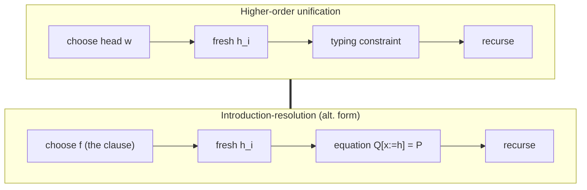

[[book-guidelines|↩ Back to guidelines]]

# Higher-Order Unification and Resolution

The paper's first section is a review with a thesis: **Huet's higher-order unification and higher-order resolution rest on the same idea, enumerating normal $\eta$-long terms of a given type.** Seeing that is what lets Dowek merge them.

## Higher-order unification as term enumeration (§1.2)

**Problem.** Given an unknown $x$ of type $T$, which terms could $x$ be? Take $T=P_1\to\dots\to P_n\to P$ with $P$ atomic. Any normal $\eta$-long inhabitant starts with $n$ abstractions:

$$t=[x_1{:}P_1]\dots[x_n{:}P_n]\,t',\qquad t'\ \text{atomic of type }P.$$

The head of $t'$ is a variable $w:Q_1\to\dots\to Q_p\to Q$ from the context (or one of the $x_i$), and to type-check we need $Q=P$. It must be applied to $p$ arguments, and since each argument may use the $x_j$:

$$t=[x_1{:}P_1]\dots[x_n{:}P_n]\,\bigl(w\ (h_1\,x_1\dots x_n)\ \dots\ (h_p\,x_1\dots x_n)\bigr)$$

with fresh unknowns $h_i : P_1\to\dots\to P_n\to Q_i$, which are then solved *recursively by the same procedure*.

The method, in the paper's four bullets:

1. try all possible head variables of the normal $\eta$-long form,
2. generate new variables for the rest of the term,
3. generate a typing constraint that enforces well-typedness,
4. recurse to fill the new variables.

In unification this is used on **flexible-rigid** equations: the rigid side restricts the choice of $w$ to very few candidates. **Rigid-rigid** equations simplify (decompose). **Flexible-flexible** equations are solved trivially in the simply typed case ([[Unification-in-Type-Systems]] explains why that fails here).

### Rust

```rust
/// One Huet-style "projection / imitation" step for a flexible head.
fn expand_flexible(goal_ty: &Pi, ctx: &Ctx, fresh: &mut Fresh) -> Vec<Candidate> {
    let (binders, atom_ty) = goal_ty.telescope();     // (x1:P1)...(xn:Pn) P
    let mut out = vec![];
    for w in ctx.vars().chain(binders.vars()) {       // try all heads
        if head_type_matches(ctx, w, &atom_ty) {      // same atomic target
            let holes = w.arg_types()
                .map(|q| fresh.meta_applied_to(&binders, q))   // h_i x1..xn
                .collect();
            out.push(Candidate::abs(binders.clone(), Term::app(w, holes)));
        }
    }
    out
}
```

## Higher-order resolution on Horn clauses (§1.3)

A **Horn clause** is $Q_1\to\dots\to Q_n\to Q$ with all $Q_i,Q$ atomic (free variables implicitly universally quantified). The **introduction-resolution** algorithm is:

- *Resolution:* if the goal $P$ is atomic, unify it with the head $Q$ of a hypothesis and recursively prove the instantiated premises $\sigma Q_1,\dots,\sigma Q_n$, where $\sigma$ is the unifier of $P$ and $Q$.
- *Introduction:* if the goal is $P_1\to\dots\to P_n\to P$, assume the $P_i$ and prove $P$.

It extends to **hereditary Horn clauses** ($Q_1,\dots,Q_n$ themselves hereditary Horn). This is Prolog's strategy for the first-order case. It is **incomplete** in general; Huet's *splitting rule* repairs it.

### Python: first-order resolution core

```python
def prove(goal, hyps, subst):
    # hyps: list of (premises, head); goal atomic
    for premises, head in hyps:
        s = unify(goal, head, subst)          # the "unification step"
        if s is None:
            continue
        for sub in premises:                  # prove sigma Q_i
            s = prove(apply(s, sub), hyps, s)
            if s is None: break
        else:
            return s
    return None
```

## The type-systems version (§1.4)

In a type system every proposition is a hereditary Horn clause with $\to$ generalised to the dependent product, **and the algorithm must return a proof term**. Dowek restates it:

- **Introduction.** To prove $(x{:}P_1)P$ in $\Gamma$, prove $P$ in $\Gamma[x{:}P_1]$; from a proof $t$ get $[x{:}P_1]t$.
- **Resolution.** To prove $P$ using $f:(x_1{:}Q_1)\dots(x_n{:}Q_n)Q$, unify $P$ with $Q$ (treating $x_i$ as variables). For each $x_i$ not instantiated by the unifier, prove $\sigma Q_i$. The proof is $(f\,c_1\dots c_n)$.

**Worked example (p. 4).** Hypothesis $f:(x{:}T)(y{:}T)(z{:}T)(u{:}R\,x\,y)(v{:}R\,y\,z)\,(R\,x\,z)$, goal $(R\,a\,c)$. Unifying $(R\,x\,z)$ with $(R\,a\,c)$ gives $x\leftarrow a,\ z\leftarrow c$. Still to find: $b{:}T$, $t{:}R\,a\,b$, $u{:}R\,b\,c$. Proof: $(f\,a\,b\,c\,t\,u)$. Note $y=b$ is *not determined* by unification: it is found while proving the premises.

The **alternative presentation** is the crucial one. Instead of "unify, then solve subgoals", give the proof shape immediately:

- Introduction: give $[x{:}P_1]h$ with $h$ a hole to be proved.
- Resolution: give $(f\,h_1\dots h_p)$ **together with the equation** $Q[x_1\leftarrow h_1,\dots,x_p\leftarrow h_p]=P$. Solving this equation fills some holes ($h_1,h_3$ in the example); the others ($h_2,h_4,h_5$) become subgoals.

Compare: that is exactly the four-bullet enumeration method of §1.2. So **resolution and unification are the same mechanism**, and the "unification step" is just the typing constraint of bullet 3.



## §1.5: what is new in this paper

Dowek takes this one idea and makes it complete for the cube: enumerate the inhabitants of $x{:}T$ by

$$x\leftarrow[x_1{:}P_1]\dots[x_n{:}P_n]\,(w\,(h_1\,\vec x)\dots(h_p\,\vec x))\qquad\text{or}\qquad x\leftarrow[\vec x{:}\vec P]\,(y{:}(h_1\,\vec x))(h_2\,\vec x\,y)$$

and *keep the typing equation in the context* as a constraint on later substitutions, rather than calling a specialised solver. For completeness one must consider all $w$, and all $p$ with all types for $h_1..h_p$. In the simply typed case types are ground so the constraint is just an equality check (head selection); in $\lambda\Pi$ the constraint joins the other equations (Elliott's "accounting equation"). In the full cube there is no known unification algorithm to call, hence the one-level merge.

## Why $\eta$ matters (§1.8)

The paper works with $\eta$-conversion; the same method "should" work without it, "but, as in higher order unification, we would need to consider more elementary substitutions".

## Lean grounding

```lean
-- apply = choose head f, create holes for its arguments, unify the result type with the goal.
example (T : Type) (R : T → T → Prop)
    (f : ∀ x y z : T, R x y → R y z → R x z) (a c : T) : R a c := by
  apply f              -- unifies (R ?x ?z) with (R a c); ?y, ?u, ?v become new goals
  all_goals sorry
```

`apply f` leaves `?y : T`, `?u : R a ?y`, `?v : R ?y c`. That is exactly the "unify then subgoals, with $b$ determined later" behaviour of the worked example. *Commentary:* Lean's elaborator delays and orders these goals using metavariable dependencies, the same issue that §1.7 and [[Search-Efficiency-and-Pruning]] (rightmost variable first) address.

## How this feeds the project

*Focus Areas: `automated-reasoning`, `type-theory`.* Concepts: unification (first-order vs higher-order), constraint generation, proof search, clause simplification, Horn clauses.

- **Unification:** this is the "where a book's equality machinery is doing unification's job without naming it" thread, made explicit. The enumeration of heads + holes + typing constraint is the skeleton of both a pattern-unification-based elaborator and a Horn-clause prover.
- **Horn clauses / CHCs:** the introduction-resolution fragment is the engine of a logic-programming layer for verification conditions. In Rust, `prove` over hereditary Horn clauses with dependent types is a sensible first backend for contract discharge.
- Mechanism over theory: the four-step loop is the part that transfers to code.

## Where this leads

[[Elementary-Substitutions-and-the-Search-Tree]] makes the loop precise with exact bookkeeping of contexts, splitting and constraints, and [[Weak-Splitting-and-Incomplete-Variants]] relates a restricted form back to introduction-resolution.
