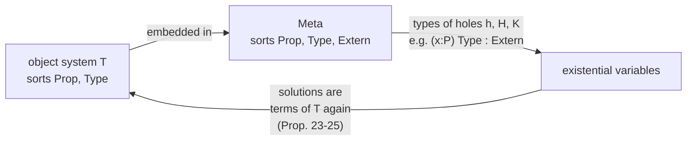

[[book-guidelines|↩ Back to guidelines]]

# Meta Type System and Existential Variables

## The problem: holes are not typable in the object system

The search procedure introduces **existential variables** that stand for "some well-typed term of the object system $\mathcal T$". Three things go wrong if you try to type those variables inside $\mathcal T$ itself (§2.2):

1. A variable standing for $Prop$ must have type $Type$, and $Type$ is *not* a well-typed term in $\mathcal T$ (it has no type).
2. A term $t:T'$ that is well-typed in $\Gamma[x{:}T]$ should be rewritable as $(f\,x)$ with $f=[x{:}T]t$ well-formed in $\Gamma$ (this is how a hole is made to depend on the context). But the product $(x{:}T)T'$ might not be well-typed in $\mathcal T$, so $f$ has no type.
3. Hence a hole's type, e.g. $(\vec x{:}\vec P)\,s$, may be ill-formed in $\mathcal T$.

What breaks: without a place to type these auxiliary terms, the algorithm's own bookkeeping is ill-typed and you cannot even state well-typedness of substitutions.

## The Meta type system (Def. 11)

Embed $\mathcal T$ in a bigger PTS:

$$S'=\{Prop,\,Type,\,Extern\},\quad Ax'=\{\langle Prop,Type\rangle,\langle Type,Extern\rangle\}$$

$$R'=\{\langle Prop,Prop,Prop\rangle,\langle Prop,Type,Type\rangle,\langle Type,Prop,Prop\rangle,\langle Type,Type,Type\rangle,\langle Prop,Extern,Extern\rangle,\langle Type,Extern,Extern\rangle\}$$

So $Meta$ is the Calculus of Constructions plus a top sort $Extern$ above $Type$ and products *into* $Extern$. It contains all eight cube systems. Now $Type$ is typable, as is $(\vec x{:}\vec P)\,s$.

**Normalisation (p. 9).** Strong normalisation and confluence of $\beta\eta$ for Meta are "not yet fully proved" in the paper. Since everything typable in Meta is typable in CC with universes (identify $Extern$ with $Type_1$), $\beta$-reduction is strongly normalising and confluent; the $\beta\eta$ case relies on a conjecture of Geuvers (SN of $\beta$ implies SN of $\beta\eta$). Prop. 6 then gives unique types modulo $\beta\eta$ (Meta is functional).

For CC with universes (§8) no Meta system is needed, because every term the algorithm builds is already typable. Dowek's general remark: for an arbitrary normalisable PTS $\mathcal T$, you need only define its Meta system.

### Rust sketch

```rust
// Sorts of the *meta* level: one more than the object system.
enum MSort { Prop, Type, Extern }

// Holes are typed in the Meta system; the object system never sees them.
struct MetaVar {
    id: u32,
    ty: Term,          // a type in Meta; may be (x1:P1)...(xn:Pn) Type
}
```

## Existential variables as functions of the context

The most important convention is how a hole depends on the binders around it. The elementary substitutions of §4 never introduce a bare $h_i$; they introduce

$$h_i\ x_1\ \dots\ x_n$$

where $x_1,\dots,x_n$ are *all* the variables bound by the abstractions above it. The hole itself is declared with the **closed** type $(\vec x{:}\vec P)\,Q_i$, so $h_i$ is an existential of function type that is then applied to the local variables. This makes the dependency explicit: $h_i$ may only use $x_j$ by receiving them as arguments.

This is the Miller / higher-order-pattern discipline (cf. his mixed prefixes, [[Contexts-Quantifiers-and-Constraints]]). The "does the unknown depend on this local variable?" question becomes the syntactic question "is $x_j$ among the arguments of $h_i$?".

### Lean

```lean
-- In a tactic block, `?m` is a metavariable with its own local context.
example (p q : Prop) (hp : p) (hq : q) : p ∧ q := by
  refine ⟨?a, ?b⟩      -- two holes, each remembering {p q hp hq}
  · exact hp
  · exact hq
```

*Author's commentary:* Lean stores each metavariable together with its local context, which is the efficient equivalent of Dowek's "closed hole applied to all context variables". `refine` with `?a` is exactly "give a proof $(\text{And.intro}\ h_1\ h_2)$ with new existential variables $h_1,h_2$".

## Where holes appear in the algorithm

In an elementary substitution (§4, Def. 27) for a variable $x:(\vec x{:}\vec P)P$ with a chosen head $w : (y_1{:}Q_1)\dots(y_q{:}Q_q)Q$:

- fresh existentials $h_i : (\vec x{:}\vec P)\,(Q_i\ (h_1\,\vec x)\dots(h_{i-1}\,\vec x))$, with $Q_i$ the $\lambda$-abstracted version of $Q'_i$ in the statement of Def. 27;
- when the head's type has fewer products than applications are needed ("splitting"), extra existentials $H_i : (\vec x{:}\vec P)\,s_i$ and $K_i : (\vec x{:}\vec P)(z{:}(H_i\,\vec x))\,s'_i$ for the unknown domain and codomain.

Their types are typable only in Meta (Prop. 17: the context $\Delta\gamma$ is well-formed in Meta; for instance the type of $H_i$ ends in a sort $s_i\in\{Prop,Type\}$, and $(\vec x{:}\vec P)s_i$ may live in $Extern$).



The last arrow matters: a *solution* found in Meta must be shown to be a legitimate proof in $\mathcal T$. Props. 23–25 do this by requiring that every product in the solution obey $\mathcal T$'s rules $R$ and that only $Prop$ occurs as a sort ([[Soundness-and-Completeness]]).

## How this feeds the project

*Focus Areas: `type-theory`, `automated-reasoning`.* Concepts: metavariables, unification, elaboration, trusted kernels.

- **Trusted kernel boundary.** Meta is a precise statement of a design principle: the *search machinery* may use a richer, even partly-ill-typed language than the *kernel*; the kernel only ever sees the final, closed, $\mathcal T$-typed proof. In Rust, that is two term types (or one with a `Hole` variant that the kernel's `check` rejects) and a translation function `fn lower(meta: &Term) -> Result<Term, Unsolved>`.
- **Elaborator metavariables.** Holes of the form `(?h x1 ... xn)` are exactly Miller patterns when the $x_i$ are distinct bound variables; that is the tractable fragment for unification and the reason this representation is attractive.
- Universe levels as metavariables (the §8 remark about sort variables and floating universes) is the ancestor of Lean's level metavariables.

## Where this leads

The types given here to holes are what [[Substitutions-Under-Quantified-Contexts]] needs to define well-typed substitutions, and what the constraint "the instantiated term has the expected type" in [[Elementary-Substitutions-and-the-Search-Tree]] is written in.
