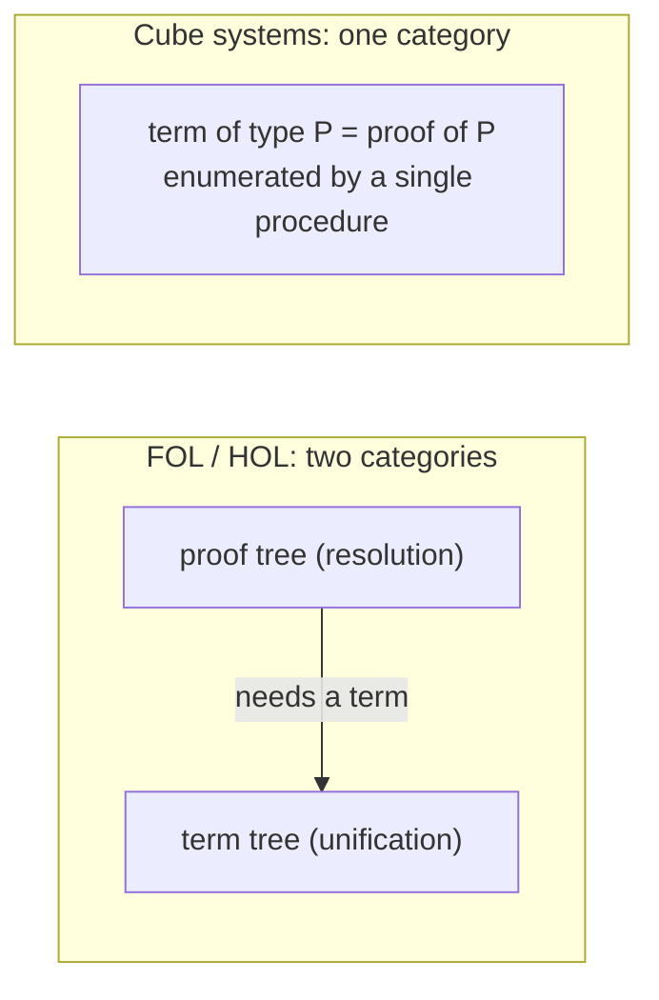

[[book-guidelines|↩ Back to guidelines]]

# Proofs-as-Objects and Proof Synthesis

## The problem this idea solves

Classical automated deduction has **two languages glued together**. In first-order or higher-order logic there are *terms* (the things you quantify over) and *proofs* (trees of inference rules). A proof of $\forall x{:}A.\,B$ applied to a term $t{:}A$ gives a proof of $B[x\leftarrow t]$, so proofs and terms are interleaved in one tree but live in different syntactic categories.

Dowek's example (§1.1) is a proof tree in which a subtree such as $[x{:}T]\,x : T \to T$ is a *term derivation* sitting inside a *proof derivation*. The consequence for a prover is a **two-level search**:

- **Resolution** searches for the proof tree.
- Whenever the proof tree needs a term, it calls out to a separate **unification** algorithm.

Two algorithms, two data structures, and an interface between them that has to be designed and kept consistent.

## The proofs-as-objects move

In the Calculus of Constructions and the other systems of Barendregt's cube, a **proof of a proposition $P$ is just a term whose type is $P$** (the Heyting reading of the connectives plus the Curry–Howard isomorphism; Introduction, p. 1). Propositions are types, proofs are terms, and the rule "$\forall$-elim" is simply function application. There is *one* syntactic category.

Consequence, in the paper's own words (§1.1): "our algorithm is a one level process merging resolution and unification." The author's claim in the Introduction is that this richer calculus makes proof synthesis *simpler*, even though the type systems are more powerful than Church's higher-order logic.



## What "proof synthesis" means precisely

**Proof synthesis** (the problem): given a context $\Gamma$ and a type $P$ that is well-typed in $\Gamma$, find a term $t$ with $\Gamma \vdash t : P$. In type-theory vocabulary this is *type inhabitation*; in logic it is *theorem proving that returns the proof*. §1.4 notes the key difference from mere provability: a synthesis method "must not only assert that the proposition is provable but also exhibit a proof-term".

Since typing is decidable in these systems, a semi-decision procedure exists trivially. The Conclusion (p. 28) spells it out: enumerate all character strings until one is a proof of $P$. That is correct and useless. The paper then ranks improvements:

| Strategy | What it enumerates | Comment from the paper |
|---|---|---|
| Strings | all lists of characters | "no practical interest" |
| Normal $\lambda$-terms / proof trees | only well-formed candidates | comparable to early-1960s searches for a counter Herbrand model |
| Resolution (Robinson for FOL, Huet for HOL) | only instantiations that can match the goal or a premise | instantiate $x$ in $\forall x.(P\,x)$ by $t$ only if $(P\,t)$ matches |
| **This paper** | normal $\eta$-long terms, guided by type constraints | "blind enumeration of proof-terms regulated by a failure anticipation mechanism exploiting type constraints" |

"What breaks without it": if you keep the two-level architecture, every extension of the logic (polymorphism, dependent types) forces you to extend both the resolution algorithm and the unification algorithm and to re-prove their interface. The paper notes that unification algorithms were known only for the simply typed $\lambda$-calculus and for $\lambda\Pi$ (§1.4), so a two-level design simply has no unifier to call for the full cube.

## Grounding in code

### Rust: one AST, not two

```rust
// Two-level (FOL style): proofs and terms are different types.
enum FoTerm { Var(usize), App(Box<FoTerm>, Vec<FoTerm>) }
enum FoProof {
    Hyp(usize),
    ImpElim(Box<FoProof>, Box<FoProof>),   // proof, proof
    AllElim(Box<FoProof>, FoTerm),         // proof, *term*  <- the interface
}

// One-level (cube style): a proof IS a term.
enum Term {
    Sort(Sort),                        // Prop, Type
    Var(usize),                        // de Bruijn index
    App(Box<Term>, Box<Term>),         // covers ->-elim AND forall-elim
    Lam(Box<Term>, Box<Term>),         // [x : T] t   (-> intro / forall intro)
    Pi(Box<Term>, Box<Term>),          // (x : T) T'  (-> and forall)
}
```

Notice that `ImpElim` and `AllElim` collapse into the single `App`. The checker, the printer, the substitution routine, and the search procedure are written once.

### Lean: the proof is literally the term

```lean
variable (T : Prop) (R Eq : T → T → Prop)
variable (antisym : ∀ x y : T, R x y → R y x → Eq x y)
variable (a b : T) (u : R a b) (v : R b a)

-- Dowek's §5.1 example. The *proof* is an application term.
example : Eq a b := antisym a b u v
```

`antisym a b u v` is the term `(Antisym a b u v)` that Dowek's algorithm synthesises in §5.1. Lean's `exact`, `apply` and `refine` tactics are, mechanically, ways of building such a term top-down with holes (see [[Higher-Order-Unification-and-Resolution]] and [[Elementary-Substitutions-and-the-Search-Tree]]).

### Python: the useless-but-correct semi-decision procedure

```python
from itertools import count

def synthesize_blind(gamma, goal, enumerate_terms, check):
    # Correct whenever `check` is decidable; hopeless in practice.
    for t in enumerate_terms():            # all candidate terms, by size
        if check(gamma, t, goal):
            return t
```

Everything in the paper is about replacing `enumerate_terms()` by a generator that never produces a term that is *already known* to be ill-typed or mismatched with the goal.

## How this feeds the project

*Focus Areas: `type-theory`, `automated-reasoning`.*

- **Judgment forms as the shared ancestor of type checker and proof checker.** This topic is the clearest instance: a single judgment $\Gamma\vdash t:T$ is both "this term has this type" and "this is a proof of this proposition". A Rust verifier with one term representation and one `check` function gets both for free.
- **Proof certificates / trusted kernel.** Because a synthesised proof is an ordinary term, it can be re-checked by a small kernel regardless of how the search found it (the soundness theorem in [[Soundness-and-Completeness]] says the search is correct anyway, but the kernel re-check is cheap defense in depth). This is the "proof-producing architecture" the project wants.
- **Metavariables and unification** enter as soon as search needs a term it does not have yet; that is the subject of the next several notes.

*Author's commentary (not from the book):* Lean's elaborator is the production-grade descendant of this picture: one `Expr` type for terms and proofs, metavariables for holes, and a unifier (`isDefEq`) that doubles as the engine of `apply`.

## Where this leads

Everything else in the paper presupposes that terms and proofs share a syntax: [[Pure-Type-Systems-and-Barendregts-Cube]] fixes the calculus, and the one-level search of [[Elementary-Substitutions-and-the-Search-Tree]] is only possible because of this identification.
