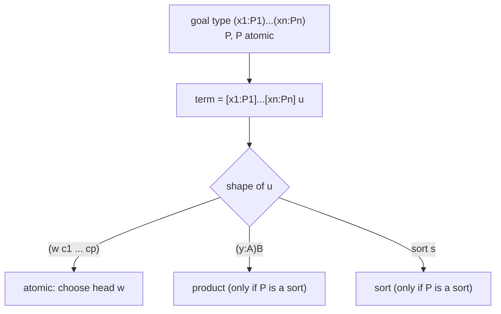

[[book-guidelines|↩ Back to guidelines]]

# Pure Type Systems and Barendregt's Cube

## Why a "pure type system" at all

Systems F, $F\omega$, $\lambda\Pi$ and the Calculus of Constructions differ in *which kinds of abstraction are allowed*: terms over types, types over terms, types over types. Rather than write four sets of typing rules, a **pure type system** (PTS) uses one set of rules parameterised by a small table. Dowek wants a proof-synthesis algorithm that works for all eight systems at once, so the parameterisation is exactly what he needs: the algorithm reads the table.

What breaks without this: you would have to restate and re-prove the search procedure for each calculus separately.

## The parameters

A PTS with $\eta$-conversion (§2.1, Def. 1) is given by

- a set $S$ of **sorts**,
- a set $Ax \subseteq S\times S$ of **axioms** ($\langle s,s'\rangle \in Ax$ reads "$s : s'$"),
- a set $R \subseteq S\times S\times S$ of **rules**. $\langle s,s',s''\rangle\in R$ says: a product $(x{:}T)T'$ with $T:s$ and $T':s'$ lives in sort $s''$.

It is **functional** if $Ax$ and $R$ are partial functions: $s$ determines $s'$, and $(s,s')$ determines $s''$. Functionality is what yields *unique types up to $\beta\eta$* (Prop. 3).

For the cube, take $S=\{Prop, Type\}$, $Ax=\{\langle Prop,Type\rangle\}$, always include $\langle Prop,Prop,Prop\rangle$, and require $s'=s''$ in every rule. Since $s'=s''$, each rule is determined by the pair $(s,s')$, and there are three optional ones, hence $2^3=8$ systems.

*Author's commentary (standard cube dictionary, using $Prop=\star$ and $Type=\square$):*

| Optional rule $\langle s,s',s'\rangle$ | What it permits | System with just this extra |
|---|---|---|
| $\langle Type,Prop,Prop\rangle$ | propositions/terms quantified over types | System F |
| $\langle Prop,Type,Type\rangle$ | types depending on terms | $\lambda\Pi$ |
| $\langle Type,Type,Type\rangle$ | type-level functions | $\lambda\underline\omega$ |
| all three | | Calculus of Constructions |

The paper names simply typed $\lambda$-calculus, $\lambda\Pi$, System F, $F\omega$ and CC as examples.

## Syntax

$$T ::= s \mid x \mid (T\,T) \mid [x{:}T]\,T \mid (x{:}T)\,T$$

Variables, sorts, application, abstraction $[x{:}T]t$ (the paper's $\lambda$), and product $(x{:}T)T'$ (the paper's $\Pi$). $T\to T'$ abbreviates a product with no dependency. $t\equiv t'$ means $\beta\eta$-equivalence. Dowek ignores renaming and says a rigorous presentation would use de Bruijn indices.

### Rust

```rust
#[derive(Clone, PartialEq)]
enum Sort { Prop, Type }

#[derive(Clone, PartialEq)]
enum Term {
    Sort(Sort),
    Var(usize),                     // de Bruijn index
    App(Box<Term>, Box<Term>),
    Lam(Box<Term>, Box<Term>),      // [x : T] body
    Pi(Box<Term>, Box<Term>),       // (x : T) body
}

struct Pts {
    axioms: Vec<(Sort, Sort)>,
    rules:  Vec<(Sort, Sort, Sort)>,
}

impl Pts {
    /// Functionality makes this a lookup, not a search.
    fn rule(&self, s: Sort, s2: Sort) -> Option<Sort> {
        self.rules.iter().find(|r| r.0 == s && r.1 == s2).map(|r| r.2.clone())
    }
}
```

## The typing judgments

Two inductively defined judgments (Def. 4): "$\Gamma$ well-formed" and "$\Gamma\vdash t:T$". The rules are Empty, Declaration, Sort, Variable, Product, Abstraction, Application and Conversion. Two are worth reading slowly.

$$\frac{\Gamma\vdash t:(x{:}T)T' \qquad \Gamma\vdash t':T}{\Gamma\vdash (t\,t') : T'[x\leftarrow t']}\ \text{Application}$$

The result type contains the argument: this is *dependency*. It is also why unification and type checking are tangled in these systems.

$$\frac{\Gamma\vdash T:s\quad \Gamma\vdash T':s\quad \Gamma\vdash t:T\quad T\equiv T'}{\Gamma\vdash t:T'}\ \text{Conversion}$$

Types are compared up to $\beta\eta$. In [[Contexts-Quantifiers-and-Constraints]] the paper replaces $\equiv$ by $\equiv_\Gamma$, which also uses equations stored in the context.

### Lean

```lean
-- Application rule: the codomain mentions the argument.
#check @Nat.rec                -- motive depends on the major premise
example (f : (n : Nat) → Fin (n+1)) : Fin 3 := f 2   -- type is (Fin (n+1))[n := 2]

-- Conversion: `Fin (1+1)` and `Fin 2` are definitionally equal, so no cast is needed.
example (x : Fin (1+1)) : Fin 2 := x
```

Lean is not literally a PTS from the cube (its `Prop` is impredicative and `Type u` is a predicative hierarchy with $\Sigma$, inductive types and so on), but the application and conversion rules above are recognisably the same.

## Metatheory facts the algorithm leans on

- **Prop. 1:** if $\Gamma\vdash t:T$ then $T$ is a type (a sort or has a sort).
- **Prop. 2:** $\beta\eta$-reduction is strongly normalising and confluent on well-typed terms, so every well-typed term has a unique $\beta\eta$-normal form. The paper cites other work for the proofs and, for the extended Meta system and universes, says normalisation of $\beta\eta$ is partly conjectural while $\beta$ is established.
- **Prop. 3:** unique type modulo $\beta\eta$ (needs functionality).

## Normal, atomic, and $\eta$-long forms

The search procedure enumerates a canonical representative of each term, so it needs a precise notion of normal form.

- **Atomic term (Def. 7):** $(u\,c_1\dots c_n)$ with $u$ a variable or sort, the **head**.
- **Prop. 4:** a normal well-typed term is an abstraction, a product, or atomic.
- **Prop. 5:** a normal type is uniquely $(x_1{:}P_1)\dots(x_n{:}P_n)P$ with $P$ atomic. The number $n$ tells you how many abstractions the term of that type must start with.
- **$\eta$-long form (Def. 8):** apply every head variable to enough arguments that its type becomes atomic, eta-expanding as you go (e.g. $f : A\to B$ becomes $[x{:}A](f\,x)$). Well-foundedness is proved in Dowek's earlier work.
- **Subterms (Def. 10)** are *labelled by their contexts* $t_\Gamma$, because the same text means something different under different binders.

Why $\eta$-long? Because then the shape of a term is **forced by its type**: the type fixes the number of leading abstractions, and below them the term is atomic with a head chosen from the context. That is the structural fact that makes enumeration finite at each step. §1.8 notes that without $\eta$ the method would still apply but would need "more elementary substitutions".



## Extending to universes (§8)

The Calculus of Constructions with universes and without cumulativity has sorts $Prop, Type_0, Type_1,\dots$, axioms $Prop:Type_0$ and $Type_i:Type_{i+1}$, and rules including $\langle Type_i,Type_j,Type_{\max\{i,j\}}\rangle$. Dowek observes the algorithm extends with no Meta system needed (all terms already typable), but the number of product substitutions explodes, so he suggests sort variables with constraints, as in floating universes.

## How this feeds the project

*Focus Area: `type-theory`.* Concepts surfaced: judgments, contexts, dependent types, $\Pi$-types, definitional equality, operational semantics.

- **Load-bearing:** the $\eta$-long normal form and Prop. 5 are what make a *goal-directed* elaborator tractable: knowing the goal type tells you the outer binders. Any Rust implementation of `isDefEq` plus a search tactic wants a `Pi`-telescope view of types (`fn telescope(ty) -> (Vec<Binder>, Atomic)`).
- **Definitional equality:** $\equiv$ is the thing a kernel must implement; here it is $\beta\eta$. The conversion rule is the single place where evaluation enters typing.
- A parameterised `Pts` struct is a cheap way to prototype the kernel for several calculi before committing to one surface language.

## Where this leads

[[Contexts-Quantifiers-and-Constraints]] extends the notion of context, [[Meta-Type-System-and-Existential-Variables]] enlarges the sort set so that holes are typable, and [[Elementary-Substitutions-and-the-Search-Tree]] enumerates exactly the $\eta$-long normal forms defined here.
