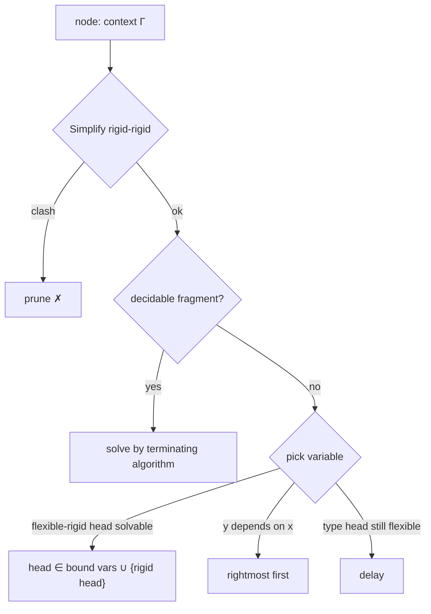

[[book-guidelines|↩ Back to guidelines]]

# Search Efficiency and Pruning

The complete method of [[Elementary-Substitutions-and-the-Search-Tree]] is a semi-algorithm over an infinitely branching tree. Section 7 lists the ways to avoid exploring most of it. The unifying principle: **recognise a node that cannot lead to a success node as early as possible, and instantiate variables in an order that makes constraints bite.** This is constraint propagation, with terms as the domain.

## 7.1 Incremental partial checking: `Simplify`

Constraints are refined to triples $\langle\delta,a,b\rangle$ where $\delta$ is a context of universal variables (the binders under which $a$ and $b$ live), and $a,b$ have the same type in $\Delta\delta$. Only constraints well-typed *without* constraints are considered. While a **rigid-rigid** constraint exists and no failure has occurred, rewrite it (Def. 36), with $\delta$ the local binders:

| Constraint $\langle\delta,\ a=b\rangle$ | Replacement |
|---|---|
| both abstractions $[x{:}T]a'$, $[x{:}U]b'$ (types are equal since $a,b$ have the same type) | $\langle\delta[\forall x{:}T],\ a'=b'\rangle$ |
| both products $(x{:}T)a'$, $(x{:}U)b'$ | $\langle\delta,T=U\rangle$ and $\langle\delta[\forall x{:}T],\ a'=b'\rangle$ |
| both atomic, same head variable, same arity: $(w\,u_1..u_p)$ vs $(w\,t_1..t_p)$ | $\langle\delta,u_1=t_1\rangle,\dots,\langle\delta,u_p=t_p\rangle$ |
| anything else | **fail**: prune this branch |

This is very similar to Huet's SIMPL function. In first-order terms it is *decomposition plus clash detection*.

```rust
enum Simp { Ok(Vec<Constraint>), Fail }

fn simplify(c: &Constraint) -> Simp {
    use Term::*;
    match (&c.a, &c.b) {
        (Lam(t, a), Lam(_, b)) => Simp::Ok(vec![c.under(t, a, b)]),
        (Pi(t, a),  Pi(u, b))  => Simp::Ok(vec![c.same(t, u), c.under(t, a, b)]),
        (App(..), App(..)) if same_head(&c.a, &c.b) && same_arity(&c.a, &c.b) =>
            Simp::Ok(zip_args(&c.a, &c.b).map(|(x, y)| c.same(x, y)).collect()),
        _ => Simp::Fail,                         // rigid clash
    }
}
```

## 7.2–7.3 Use the flexible constraints

- **Flexible-rigid** (7.2). If the head of a flexible term can be instantiated (the head of *its type* is rigid), do it first. The candidates for its head are only the bound variables and **the head of the rigid term**; any other choice yields an unsolvable rigid-rigid constraint. So the constraint cuts the branching factor from "every variable in scope" to a handful.
- **Flexible-flexible** (7.3). If one of the heads can be solved, solve it first. It does not restrict the options itself, but it may turn the constraint into flexible-rigid at the next step, and "solving constraints helps to unfreeze types of existential variables and constraints that are not well-typed without the constraints" (cf. [[Contexts-Quantifiers-and-Constraints]]).

## 7.4 Avoid splitting

If $(Q\,(h_1\vec x)\dots(h_q\vec x))$ is atomic and **rigid**, every substitution with $r\ne0$ leads to hopeless constraints, so only $r=0$ is needed. Specifically, in the $\lambda\Pi$-calculus no existential for a type or predicate is ever introduced, so **splitting can always be avoided**. Splitting is the price of polymorphism only.

## 7.5 Solve decidable fragments with terminating algorithms

When a constraint is well-typed without constraints and belongs to one of:

- first-order unification (Robinson),
- argument-restricted unification (Miller's patterns),
- second-order matching, or second-order-argument-restricted matching,

run the corresponding **terminating** algorithm and apply its output, instead of exploring the generic enumeration. Consequently, "the elimination of a first-order universal quantifier is a one-step operation", whereas higher-order quantifier elimination takes several steps and can backtrack.

## 7.6 Priority to the rightmost variable (and §1.7)

If $y$ is declared to the right of $x$ and $x$ occurs in $y$'s type, instantiate $y$ first when both are instantiable.

**Example.** Axiom $u:(P\,n)$, goal: find an integer $x$ with $(P\,x)$. Existentials: $x{:}Nat$, $y{:}(P\,x)$.

- Start with $y$: instantiate $y\leftarrow u$, the constraint $(P\,n)=(P\,x)$ forces $x\leftarrow n$. One step.
- Start with $x$: try $0,1,2,\dots$, failing to prove $(P\,0),(P\,1),\dots$ until $n$.

```python
def find_x(axioms, predicate):
    # rightmost first: look for a proof of (P x) among the axioms, let unification pick x
    for ax in axioms:
        s = unify(ax.type, predicate("x"))
        if s: return s["x"]
```

*What breaks without this:* a witness search that enumerates the witness domain. This is the classic distinction between *generate-and-test* and *constraint-directed* search.

## 7.7 Normalising some ill-typed terms

Terms typable only through unsolved constraints may not normalise, so the algorithm cannot inspect them. Dowek proposes (as an "important improvement") to recognise some normalisable ill-typed terms: e.g. for a normal $\eta$-long $t$ and an elementary substitution $x\leftarrow[\vec x{:}\vec P]\,u$ where $u$ is a product or an atom headed by a universal variable or sort (not one of the $x_i$), the term $\sigma t$ is normalisable. Then constraints involving it can be used earlier. This is stated as future work.

## §8 and universes

In the Calculus of Constructions with universes and no cumulativity, a variable $x{:}Prop$ can be instantiated by infinitely many products $(y{:}h)(k\,y)$ with $h{:}Type_i$. Proposed remedy: **sort variables with constraints** (floating universes, Harper–Pollack, Huet).



## How this feeds the project

*Focus Areas: `automated-reasoning`, `sat-smt-csp`.* Concepts: constraint solving, domain propagation, unification, clause simplification.

- **Constraint propagation over terms.** `Simplify` is a propagator; "solve flexible-rigid first" is variable ordering (fail-first/most-constrained); delayed instantiation is lazy domain expansion. A CSP kernel in the planned compiler can reuse the same loop structure: propagate to fixpoint, branch on the most constrained unknown, prune on clash.
- **Pattern unification as the tractable fragment** (7.5): the argument-restricted case is Miller's pattern fragment, the one the project's elaborator targets. Detect "is this constraint a pattern?" cheaply and solve it deterministically; fall back to enumeration only otherwise.
- **Dependency-aware ordering** (7.6) is the elaborator-side rule behind "synthesise implicit arguments from later arguments' types". *Commentary:* Lean's elaborator postpones `?m` whose type mentions another unassigned `?n` for a similar reason.
- Implementation tradeoff: Dowek's heuristics are *sound with respect to the search tree*; they prune only branches that cannot succeed (7.1–7.4) or reorder (7.6), so completeness is preserved. 7.5 should be checked per fragment.

## Where this leads

[[Weak-Splitting-and-Incomplete-Variants]] takes the most radical cut: giving up completeness for a finitely branching tree.
