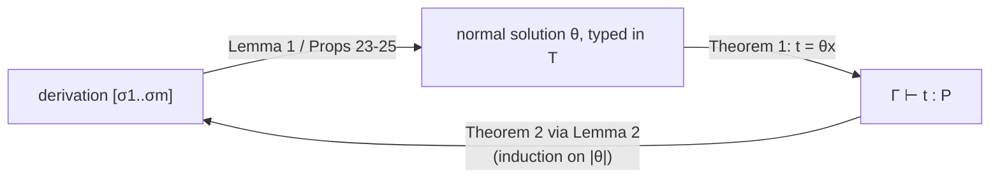

[[book-guidelines|↩ Back to guidelines]]

# Soundness and Completeness

## What has to be proved

The search procedure of [[Elementary-Substitutions-and-the-Search-Tree]] is only useful if:

- **Soundness:** any success node yields a genuine proof, i.e. a term $t$ with $\Gamma\vdash t:P$ in the object system $\mathcal T$.
- **Completeness:** every provable $P$ *is* found: for every term $t$ with $\Gamma\vdash t:P$, the tree contains a success node denoting the normal $\eta$-long form of $t$.

What breaks if one fails: unsound means the prover returns "proofs" the kernel would reject; incomplete means some true statements are never reached however long you search. Dowek proves both (Theorems 1 and 2).

## 6.1 The groundwork: substitutions are well-typed

Before either theorem, Props. 17–19 show that each elementary substitution $\sigma=x\leftarrow\gamma,t$ in $\Sigma(\Gamma)$ is well-typed in $\Gamma$ in **Meta**:

- **Prop. 17:** $\Delta\gamma$ is well-formed in Meta (every new hole type and constraint is typable, using that the relevant sorts are $Prop$ or $Type$, not $Extern$).
- **Prop. 18:** $\Delta\gamma\vdash t:T$. For $r=0$ this follows from the constraint $\psi$. For $r\ge1$, an induction on $i$ shows $[\vec x{:}\vec P](w\,h_1..h_{q+i})$ has type $(\vec x{:}\vec P)(K_i\,\vec x\,(h_{q+i}\vec x))$ using the constraint of each $\chi_i$, and the last constraint $\psi$ converts that to $(\vec x{:}\vec P)P$.
- **Prop. 19:** $\sigma$ is well-typed in the whole $\Gamma$, by induction over the declarations after $x$.

By composition (Prop. 16 in [[Substitutions-Under-Quantified-Contexts]]) the composite of a derivation is well-typed too.

## 6.2 Soundness

**Solutions.** A substitution $\theta$ is a *solution* to $\Gamma$ (Def. 30) if it is well-typed in $\Gamma$ and $\theta\Gamma$ is a success context. A *normal solution* (Def. 31) binds exactly the existentials, with empty associated contexts and normal $\eta$-long values. Def. 32 normalises an arbitrary solution into a normal one by induction on the length of $\Gamma$.

**Lemma 1.** If there is a derivation $[\sigma_1;\dots;\sigma_m]$ of $\Gamma$, there is a normal solution (the normal form of $\sigma_m\circ\dots\circ\sigma_1$). This is "the substitution denoted by the derivation".

**From Meta back to $\mathcal T$ (Props. 23–25).** A solution is typed in Meta, but the user asked about $\mathcal T$. Prop. 23: if $\Gamma\vdash t:T$ in Meta, $t$ is normal $\eta$-long, **every product inside $t$ satisfies $\langle s,s',s''\rangle\in R$ of $\mathcal T$, and every sort inside $t$ is $Prop$**, then $\Gamma\vdash t:T$ already holds in $\mathcal T$ (induction on $t$). Prop. 24 shows the terms produced by a derivation satisfy those side conditions (only $R$-licensed products and sorts are ever introduced, since sort/product substitutions are chosen from $Ax$ and $R$). Prop. 25: the denoted substitution is well-typed in $\mathcal T$.

> **Theorem 1 (Soundness).** If $\Gamma$ is a (non-constrained, non-quantified) context, $P$ is well-typed in $\Gamma$, and $\Gamma'=\Gamma[\exists x{:}P]$ has a derivation, then there exists $t$ with $\Gamma\vdash t:P$ in $\mathcal T$.

*Proof sketch (p. 22).* Let $\theta$ be the denoted substitution; it is a normal solution well-typed in $\mathcal T$. With $t=\theta x$: normality gives $\theta\Gamma'=\theta\Gamma$, and since $\Gamma$ has no existentials $\theta\Gamma=\Gamma$ and $\theta P=P$. So $\theta\Gamma'\vdash\theta x:\theta P$ reads $\Gamma\vdash t:P$. The proof $t$ is called "the proof denoted by the derivation".

### Rust: the proof object comes out of the search

```rust
struct Derivation(Vec<Elem>);                 // [σ1; ...; σm]

fn denoted(d: &Derivation, root: Var) -> Term {
    // θ = σm ∘ ... ∘ σ1, then normalise to η-long normal form
    let theta = d.0.iter().rev().fold(Subst::empty(), |acc, s| acc.compose(&s.as_subst()));
    normalize_eta_long(&theta.apply_term(&Term::Var(root)))
}

// Defence in depth: the search is proved sound, but a kernel re-check is cheap.
fn certified(ctx: &Ctx, goal: &Term, d: &Derivation, root: Var) -> Result<Term, KernelError> {
    let t = denoted(d, root);
    kernel::check(ctx, &t, goal)?;            // trusted computing base stays small
    Ok(t)
}
```

*Commentary:* the paper proves the search sound, so `kernel::check` is redundant in principle. In an engineering setting the re-check is what shrinks the trusted base to the kernel alone, which is the usual proof-producing architecture.

## 6.3 Completeness

**A measure.** Define $<$ as the smallest transitive relation on normal $\eta$-long terms such that (i) a strict subterm is smaller than its term, and (ii) the (normal $\eta$-long form of the) *type* of a non-sort term is smaller than the term (Def. 33). Dowek proves in earlier work that this is well-founded ("a function that recurses both on a strict subterm and on the type of its argument is total"). Sizes by induction on $<$ (Def. 34):

| Term | $\lvert t_\Gamma\rvert$ |
|---|---|
| sort | $1$ |
| variable | $\lvert T_\Gamma\rvert$ (its type) |
| $(u\,v)$ | $\lvert u_\Gamma\rvert+\lvert v_\Gamma\rvert+\lvert T_\Gamma\rvert$ |
| $[x{:}U]u$ | $\lvert u_{\Gamma[x:U]}\rvert$ |
| $(x{:}U)V$ | $\lvert U_\Gamma\rvert+\lvert V_{\Gamma[x:U]}\rvert+\lvert T_\Gamma\rvert$ |

The size of a substitution is the sum of the sizes of its terms (Def. 35). Note that *types count* in the size of an application, which is precisely what will pay for the new variables $H_i,K_i$.

**Prop. 26.** If $\Gamma$ is a failure context then so is $\sigma\Gamma$ for every $\sigma$: ground distinct terms stay distinct.

**Lemma 2.** If $\theta$ is a normal solution of $\Gamma$, then some derivation of $\Gamma$ denotes $\theta$.

*Proof by induction on the size of $\theta$.* $\Gamma$ is not a failure context (Prop. 26), so either it is a success context (empty derivation) or Prop. 9 gives an existential $x$ with rigid atomic target. Let $t=\theta x=[\vec x{:}\theta\vec P]\,u$.

- **$u=(w\,u_1..u_p)$:** let $q$ be the number of products in $w$'s type and $r=p-q\ge0$. Take $\sigma$ the elementary substitution with head $w$ and $r$-splitting; let $\theta'$ assign each $h_i$ the term $[\vec x{:}\vec P]u_i$ and each $H_i,K_i$ the abstracted domain and codomain of the $i$-th extra product. Then $\theta=\theta'\circ\sigma$ and $|\theta'|<|\theta|$, because
$$|\theta x|=|T_0|+|u_1|+|T_1|+\dots+|u_p|+|T_p|\ >\ \textstyle\sum|U_i'|+\sum|V_i'|+\sum|u_i'|=|\theta'|\text{-part},$$
the dropped terms $T_0..T_{q-1}$ and the splitting of each $T_{q+i}=(y{:}U_i)V_i$ into $U_i,V_i$ account for the strict decrease.
- **$u=(y{:}U)V$ (product):** use the product substitution, with $h\mapsto[\vec x]U$, $k\mapsto[\vec x][y{:}U]V$; and $|(y{:}U)V|>|U|+|V|$.

By the induction hypothesis a derivation $D$ of $\sigma\Gamma$ denotes $\theta'$; then $[\sigma]\,D$ denotes $\theta$. $\square$

> **Theorem 2 (Completeness).** If $\Gamma\vdash t:P$ in $\mathcal T$, then $\Gamma[\exists x{:}P]$ has a derivation denoting the normal $\eta$-long form of $t$.

*Proof (one line):* $\theta=\{\langle x,[\,],t'\rangle\}$ with $t'$ the normal $\eta$-long form of $t$ is a normal solution; apply Lemma 2.



## How this feeds the project

*Focus Areas: `automated-reasoning`, `type-theory`.* Concepts: proof certificates, proof reconstruction, trusted kernels.

- **Load-bearing for the soundness argument:** the structure "search in a rich auxiliary system (Meta), prove that results land in the kernel's system" is the shape of soundness proof a refinement-type verifier's solver will need. The side conditions of Prop. 23 (only $R$-licensed products, only $Prop$ as a sort) are a concrete checklist for "what the search is allowed to build".
- **Termination measure for completeness proofs:** the type-inclusive size is a reusable trick: when induction on a term needs its type to shrink too, include the type's size in the measure.
- **Lean:** the analogous fact is that tactic-generated terms are re-checked by the kernel (`Lean.Meta.check` / kernel typechecking at `theorem` elaboration), so tactic bugs cannot create unsoundness. The paper proves the stronger property that the search itself is sound.

## Where this leads

Completeness is of the *method* with infinite branching; the next note ([[Search-Efficiency-and-Pruning]]) and [[Weak-Splitting-and-Incomplete-Variants]] trade parts of it for speed.
