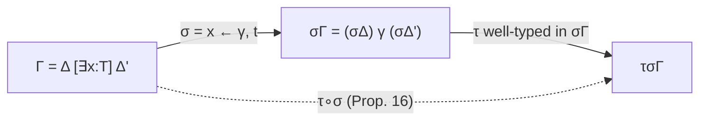

[[book-guidelines|↩ Back to guidelines]]

# Substitutions Under Quantified Contexts

## Why the usual "map from variable to term" is not enough

In plain unification a substitution is a map $x\mapsto t$. Here it cannot be, for two reasons.

1. **Instantiating a variable creates new variables.** Replacing $x$ by $(w\,h_1\,h_2)$ introduces the existentials $h_1,h_2$ *with their own types and constraints*. Those must go into the context exactly where $x$ was, so that the quantifier order is preserved.
2. **Types depend on earlier variables.** If $x$ occurs in the type of a later declaration, instantiating $x$ changes that type.

So the substitution must carry **the context that the instantiation brings with it**. What breaks otherwise: new existentials end up declared in the wrong place (after something that should not see them, or before something they need), and well-scopedness is lost.

## Definitions (§3.2)

- **Existential context (Def. 20):** contains only $\exists$-declarations and constraints, no $\forall$.
- **Substitution (Def. 21):** a finite set of triples $\langle x,\gamma,t\rangle$ with $x$ a variable, $\gamma$ an existential context and $t$ a term, with at most one triple per $x$. Written $x\leftarrow\gamma,t$. Then $x$ is **bound by** $\sigma$ and $\gamma$ is the context **associated to** $x$.
- **Application to a term (Def. 23):** $\sigma x=t$ if $\langle x,\gamma,t\rangle\in\sigma$, else $x$; extended homomorphically through sorts, application, $[x{:}T]u$ and $(x{:}T)u$.
- **Application to a context (Def. 24):**

$$\sigma[\,]=[\,],\qquad \sigma(\Delta[Qx{:}T])=(\sigma\Delta)\,\gamma\ \ \text{if }x\text{ is bound by }\sigma,\ \text{else }(\sigma\Delta)[Qx{:}\sigma T],\qquad \sigma(\Delta[a=b])=(\sigma\Delta)[\sigma a=\sigma b].$$

The first clause is the point: the declaration of $x$ is *replaced by the whole context $\gamma$*.

### Rust

```rust
struct Triple {
    var: Var,
    gamma: Vec<Item>,   // existential context only (Exists + Constraint)
    term: Term,
}
struct Subst(Vec<Triple>);   // at most one triple per variable

fn apply_ctx(s: &Subst, ctx: &Ctx) -> Ctx {
    let mut out = Vec::new();
    for item in &ctx.0 {
        match item {
            Item::Decl { var, .. } if s.binds(*var) => {
                out.extend(s.get(*var).gamma.clone());      // splice in γ
            }
            Item::Decl { q, var, ty } =>
                out.push(Item::Decl { q: *q, var: *var, ty: apply_term(s, ty) }),
            Item::Constraint(a, b) =>
                out.push(Item::Constraint(apply_term(s, a), apply_term(s, b))),
        }
    }
    Ctx(out)
}
```

## When is a substitution allowed? (Def. 25)

$\sigma$ is **well-typed in $\Gamma$** iff

1. $\sigma\Gamma$ is well-formed,
2. **no universal variable of $\Gamma$ is bound** by $\sigma$ (only unknowns get solved),
3. for every existential $x{:}T$ of $\Gamma$ bound by $\sigma$ via $\langle x,\gamma,t\rangle$, with $\Gamma=\Delta[\exists x{:}T]\Delta'$, we have
$$(\sigma\Delta)\,\gamma\ \vdash\ t:\sigma T.$$

Condition 3 is the heart: the replacement term is typed *in the part of the context that precedes $x$ (after substitution), extended by its own fresh variables $\gamma$*. That is exactly the scoping rule of the mixed prefix: $t$ may use only things declared to the left of $x$, plus what it brings.

### Lean analogue (commentary)

Assigning a metavariable `?m := e` in Lean requires that `e`'s free variables lie in `?m`'s local context and that `e` has `?m`'s type; the check is done by `checkAssignment`. Dowek's Def. 25(3) is the declarative version of that check.

## The properties that make substitutions usable

- **Prop. 10:** $T\equiv_\Gamma T'$ implies $\sigma T\equiv_{\sigma\Gamma}\sigma T'$. Equations survive instantiation.
- **Prop. 11:** if $x$ is not bound by $\sigma$ and not free in any $\sigma y$ for $y\neq x$, then $\sigma(t[x\leftarrow u])=(\sigma t)[x\leftarrow\sigma u]$. Substitution commutes with the *object-level* $\beta$-substitution; the proviso is the variable-capture guard.
- **Prop. 12:** if $x{:}T\in\Gamma$ and $\sigma$ is well-typed in $\Gamma$ then $\sigma\Gamma\vdash\sigma x:\sigma T$. (If $x$ is bound, use the typing hypothesis from Def. 25(3); the context $(\sigma\Delta)\gamma$ is a prefix of $\sigma\Gamma$.)
- **Prop. 13 (typing preservation):** $\Gamma\vdash t:T$ and $\sigma$ well-typed in $\Gamma$ imply $\sigma\Gamma\vdash\sigma t:\sigma T$, by induction on the derivation, with one case per typing rule. The application case uses Prop. 11 to get $\sigma(T'[x\leftarrow t'])=(\sigma T')[x\leftarrow\sigma t']$; the conversion case uses Prop. 10.
- **Composition (Def. 26):**

$$\tau\circ\sigma=\{\langle x,\tau\gamma,\tau t\rangle \mid \langle x,\gamma,t\rangle\in\sigma\}\ \cup\ \{\langle x,\gamma,t\rangle\in\tau\mid x\text{ not bound by }\sigma\}.$$

Props. 14, 15: $(\tau\circ\sigma)t=\tau\sigma t$ and $(\tau\circ\sigma)\Gamma=\tau\sigma\Gamma$. **Prop. 16:** if $\sigma$ is well-typed in $\Gamma$ and $\tau$ in $\sigma\Gamma$, then $\tau\circ\sigma$ is well-typed in $\Gamma$. This is what allows a *derivation* to be a list of elementary substitutions $[\sigma_1;\dots;\sigma_m]$ whose composite is well-typed ([[Elementary-Substitutions-and-the-Search-Tree]]).



## Python toy: scoping check for an assignment

```python
def can_assign(ctx, x, gamma, t, free_vars):
    # t may mention only variables declared before x in ctx, plus gamma's own.
    before = {d.name for d in ctx[:index_of(ctx, x)]}
    allowed = before | {d.name for d in gamma if d.kind == "exists"}
    return free_vars(t) <= allowed
```

Dowek's actual condition is the typing statement of Def. 25(3), which implies this scoping check and more.

## How this feeds the project

*Focus Areas: `type-theory`, `automated-reasoning`.* Concepts: substitution, contexts, metavariables, proof reconstruction.

- **Load-bearing plumbing** (the project's "substitution, context management and variable capture" thread): the guarantee that a substitution only touches existentials, extends the context in place, and preserves typing (Props. 13, 16) is the invariant an elaborator's `instantiateMVars` + assignment code must maintain. In Rust it is natural to encode it as a type: an `Assignment` can only be built by a function that checks Def. 25, so ill-scoped assignments are unrepresentable.
- **Proof reconstruction:** the final proof term is the *composition* of all substitutions (Lemma 1, [[Soundness-and-Completeness]]); composition's correctness (Prop. 16) is what makes this reconstruction trivially sound.

## Where this leads

Elementary substitutions are the concrete instances of this definition used by the search, and soundness is stated in terms of well-typed substitutions that turn the initial context into a success context.
