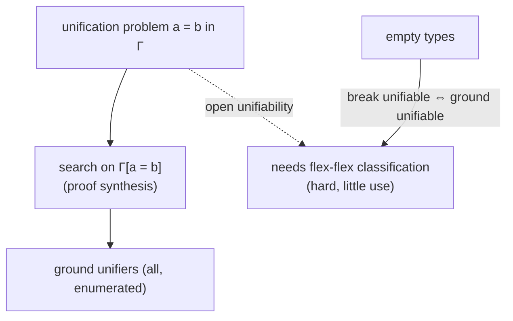

[[book-guidelines|↩ Back to guidelines]]

# Unification in Type Systems

## Turning proof synthesis into unification

A unification problem is two terms $a,b$ of the same type in a context $\Gamma$ (with universal and existential variables, no constraints): find a substitution $\theta$, well-typed in $\Gamma$, with $\theta a=\theta b$ and such that every variable bound by $\theta$ has an associated context with no constraints (§10.1).

Dowek's observation: the machinery of this paper already does it. **Run the proof-synthesis method on $\Gamma[a=b]$.** A success node is a substitution making $a=b$ trivially true, i.e. a unifier; and since the method enumerates the whole tree, it enumerates *all ground unifiers*. It is a semi-algorithm for **ground unifiability**.

(Equivalently: unification is proof search for the proposition "$a=b$", with an equation put into the context rather than proved by a term.)

## Ground vs open: the difference that matters here

In first-order and higher-order logic (and simply typed $\lambda$-calculus) we usually ask for *any* unifier, possibly leaving variables unfilled or introducing new ones. That is fine because **all types are inhabited**: from a unifier with leftover variables we can fill them with arbitrary terms and get a ground unifier. So unifiability $\iff$ ground unifiability.

In type systems there are **empty types**, e.g. $(P{:}Prop)\,P$ (a proof of every proposition). A leftover existential $z{:}E$ with $E$ empty can *never* be filled, so a "unifier" that leaves it open is not extendable to a real one. The two notions come apart. Miller's unification under a mixed prefix [26] also allows empty types and adopts ground unifiability; the paper does the same.

What breaks if you ignore this: you declare two terms unifiable because the equation has solutions *modulo an uninhabited variable*, and your solution is vacuous.

### Lean: empty types

```lean
-- `∀ P : Prop, P` is False in disguise: no closed term inhabits it.
example : ¬ (∀ P : Prop, P) := fun h => h False

-- A unification problem whose "variable" must have an empty type has no ground solution.
-- Dowek's §10.2: ∃ x : (P : Prop) → P  — no instantiation exists.
```

## Flexible-flexible equations cannot be postponed

In simply typed $\lambda$-calculus (Huet), flexible-flexible equations $(f\ldots)=(g\ldots)$ are always solvable (by constant functions, using that all types are inhabited), so one **keeps them unsolved to the end**. Here that fails: the head variables may have empty types, so the equation may have *no solution*. Dowek's example (§10.2):

$$[\forall A{:}Prop;\ \forall B{:}Prop;\ \forall u{:}A;\ \exists x{:}(P{:}Prop)\,P]\qquad a=(x\,(A\to B)\,u),\quad b=(x\,B).$$

This is flexible-flexible, yet unsolvable. *Proof (p. 28).* Suppose $\theta x=t$ solves it. $t:(P{:}Prop)P$ so $t=[P{:}Prop]\,t'$ with $t':P$. $t'$ is neither an abstraction nor a product, so it is atomic $(f\,c_1..c_n)$. If $f$ were the variable $P$ we would have $n=0$ and $t'=P$, which is ill-typed (the type of $P$ is $Prop$, not $P$). So $f\ne P$. The equation says
$$(f\ c_1[P\leftarrow A\to B]\dots c_n[P\leftarrow A\to B]\ u)=(f\ c_1[P\leftarrow B]\dots c_n[P\leftarrow B]).$$
The two sides have the same head $f$ but $n+1$ versus $n$ arguments, so the argument lists are shifted against each other; following the paper, this yields $(f\,c_1[P\leftarrow A\to B])=f$, and **a variable cannot be equal to an application**. Contradiction. (The paper gives this step in one line; the shifting is my gloss.)

Intuitively: $x$ would be a proof of $\forall P.\,P$, which cannot exist; the equation merely *looks* satisfiable.

### Rust

```rust
enum Class { RigidRigid, FlexRigid, FlexFlex }

fn handle(c: &Constraint, ctx: &Ctx) -> Action {
    match classify(c, ctx) {
        Class::RigidRigid => Action::Decompose,
        Class::FlexRigid  => Action::InstantiateHead,
        // In simply typed HOU: defer forever. In the cube: cannot defer blindly.
        Class::FlexFlex   => Action::MustSolveOrProveUnsat,
    }
}
```

## Decidability

The paper notes the problem of deciding whether a flexible-flexible unification problem has solutions under a quantified context is **undecidable** in simply typed $\lambda$-calculus [Miller 26], and the proof "generalises easily to type systems". So no complete terminating algorithm exists for the general case.

## Open unification (§10.2)

Open unifiability (solutions allowed to leave variables unfilled) is described as "a quite difficult problem with small interest": in a proof-search setting, existentials are introduced to be filled, not to remain. To do it one would have to:

- recognise which flexible-flexible equations *do* have solutions and keep those unsolved to the end, as in simply typed $\lambda$-calculus;
- cope with normalisation of terms typed using such constraints (maybe treating one normalisation step as an algorithm primitive);
- perform some product substitutions when the type of a variable in a flexible-rigid or flexible-flexible equation has an existential head.

Finding the solvable flexible-flexible equations "seems rather difficult" because the head of an elementary substitution could then be any variable of $\Gamma$ or a *new* one; it amounts to enumerating all proofs under *all possible sets of axioms*.



## How this feeds the project

*Focus Areas: `type-theory`, `automated-reasoning`.* Concepts: unification, metavariables, definitional equality, elaboration.

- **Load-bearing for the elaborator's design decision about postponement.** In a Lean-style elaborator, flex-flex constraints are postponed and often resolved by defaulting or by later information. This note explains that postponing is *unsound as a decision* in a dependent setting (the postponed equation may be unsatisfiable), so the elaborator must either report "stuck" or keep the equation for final checking. A Rust implementation should keep an explicit `Postponed(Vec<Constraint>)` list and *re-check it when the context is closed*.
- **Prefer the pattern fragment.** Because the general problem is undecidable and the sound treatment of flex-flex is hard, restrict automatically-solved problems to Miller patterns ([[Search-Efficiency-and-Pruning]] §7.5) and treat anything else as a constraint for the user-visible error path.
- **Ground unifiability as the correctness notion** for verification-condition solving: a solution must be extendable to a closed term. If the refinement language admits uninhabited types (it will, via contradictions), "found a unifier" must mean "found a term".

## Where this leads

This closes the paper. The ideas reappear in later work on metavariable-based proof search in sequent-calculus form (see the Lengrand–Dyckhoff–McKinna paper in this vault), where list metavariables remove $r$-splitting and unification constraints arise from the axiom rule.
