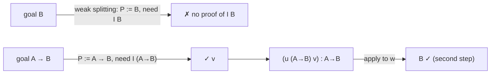

[[book-guidelines|↩ Back to guidelines]]

# Weak Splitting and Incomplete Variants

## The cost being attacked

The complete method must consider, for each head variable $w$, **every** number $r\ge0$ of extra applications beyond $w$'s declared arguments (see [[Elementary-Substitutions-and-the-Search-Tree]]). That makes the tree infinitely branching, forces interleaving, and creates many auxiliary variables $H_i,K_i$ and constraints. §9 trades completeness for a **finitely branching** search.

## The restriction (§9)

**Weak splitting:** keep only elementary substitutions with **0-splitting**, but allow the number of leading abstractions to range from $0$ to the number of products in the type of the existential variable being instantiated. The earlier method is then called **strong splitting**. The weak-splitting tree is finitely branching. (Note it still keeps product and sort substitutions as in the complete method; §9's claim is about the head-application substitutions.)

### Rust

```rust
fn sigma_weak(ctx: &Ctx, x: Var) -> Vec<Elem> {
    let (binders, p) = ctx.type_of(x).telescope();
    let mut out = vec![];
    for k in 0..=binders.len() {                 // 0..n abstractions (eta may stop early)
        for w in ctx.universals_left_of(x).chain(binders.vars()) {
            out.push(build_head_subst(ctx, x, &binders[..k], &p, w, /*r=*/0));
        }
    }
    out.extend(sort_and_product_substs(ctx, x));
    out                                           // finite
}
```

## What is lost: the induction-loading example

This is the §5.2 context again: $u:(P{:}Prop)((I\,P)\to P)$, $v:I\,(A\to B)$, $w:A$.

- **Goal $B$** needs $(u\,(A\to B)\,v\,w)$. $u$ declares two arguments and the proof applies it to a third, so strong splitting finds it (1-splitting), but the paper states that **weak splitting cannot synthesise a proof of $B$**. *Author's reading of why:* with 0-splitting the head $u$ yields $(u\,h_1\,h_2)$ whose type $h_1$ is forced to equal the goal $B$, leaving a subgoal $I\,B$ with no proof; the instance $P:=A\to B$ is not visible in the goal $B$.
- **Goal $A\to B$** is found: with variable $p':A\to B$, the substitution $p'\leftarrow(u\,h_1\,h_2)$ with $h_1{:}Prop$, $h_2{:}I\,h_1$ yields the constraint $h_1=A\to B$ (the type of the partial application against the goal), so $h_1\leftarrow(A\to B)$, $h_2\leftarrow v$. The synthesised term $(u\,(A\to B)\,v)$ is not $\eta$-long; its $\eta$-long form is $[w{:}A](u\,(A\to B)\,v\,w)$.

Dowek's diagnosis: when a hypothesis quantifies over a proposition or predicate (an induction axiom, say), weak splitting finds the instance **only when it can be read off the type of the existential variable**. It cannot do an **induction loading** (Helmink's term): strengthening the goal from $B$ to $A\to B$.



### Lean (commentary)

Lean users do exactly the "break it into a smaller provable lemma" move by hand:

```lean
variable (I : Prop → Prop) (A B : Prop)
variable (u : ∀ P : Prop, I P → P) (v : I (A → B)) (w : A)

example : B := by
  have h : A → B := u _ v      -- the strengthened goal A → B is found from v's type
  exact h w
```

`u _ v` works because the unifier solves `_ := A → B` from `v : I (A → B)`. Trying `apply u` directly on `B` instead instantiates `P := B` and leaves the unprovable `I B`. *This illustrates the phenomenon; it is not a claim about Lean's algorithm.*

## Relation to introduction-resolution (§9, §1.3–1.4)

The weak-splitting algorithm is "quite similar" to introduction-resolution [Helmink] but strictly more powerful. Example: with $u:(P{:}Prop)(P\to A)$ and $v:B\to C$, the proof $(u\,(B\to C)\,[x{:}B](v\,x)):A$ is synthesised by weak splitting but **not** by introduction-resolution. To obtain *exactly* introduction-resolution one must forbid product substitutions entirely.

| Method | Search tree | Complete? | Finds $(u\,(B\to C)\,[x{:}B](v\,x)):A$ |
|---|---|---|---|
| Introduction-resolution | finitely branching | no | no |
| Weak splitting | finitely branching | no | yes |
| Strong splitting (complete method) | infinitely branching | yes | yes |

## "Incomplete but its transitive closure is complete" (citing Dowek's thesis)

The weak method cannot synthesise every proof directly, **but every proof can be broken into smaller proofs each of which can be synthesised**. In practice: a user (or a higher layer of the prover) supplies the intermediate lemma (the strengthened goal $A\to B$, an induction hypothesis), and weak splitting does the rest. The *transitive closure* of "synthesisable in one run" is everything provable.

### Python sketch: lemma-iterating prover

```python
def prove_with_lemmas(goal, ctx, weak_search, lemma_candidates):
    p = weak_search(goal, ctx)
    if p: return p
    for lemma in lemma_candidates(goal, ctx):         # e.g. strengthened goals
        p_lemma = weak_search(lemma, ctx)
        if p_lemma:
            p = weak_search(goal, ctx + [("h", lemma, p_lemma)])
            if p: return p
    return None
```

## How this feeds the project

*Focus Area: `automated-reasoning` (with `type-theory`).* Concepts: proof search, unification, proof reconstruction.

- **Engineering tradeoff, explicitly:** completeness vs. a bounded branching factor. For an *embedded* theorem prover that must be predictable, weak splitting plus a lemma mechanism is the sane default; strong splitting is a research mode.
- **Where lemma suggestion lives:** the missing piece is *which* strengthened goal to try. That is exactly the role the project assigns to abductive reasoning and Craig interpolation / invariant generation: guess the intermediate $A\to B$. The paper's observation locates the need precisely.
- **Dependent-polymorphic systems only:** by §7.4, in the $\lambda\Pi$-calculus no splitting is needed at all, so the complete method is already finitely branching there. A refinement-type language that stays predicative and first-order in its predicates avoids the issue.

## Where this leads

[[Unification-in-Type-Systems]] turns the same enumeration into a unification procedure, where the empty-type issue makes the flexible-flexible case unavoidable.
