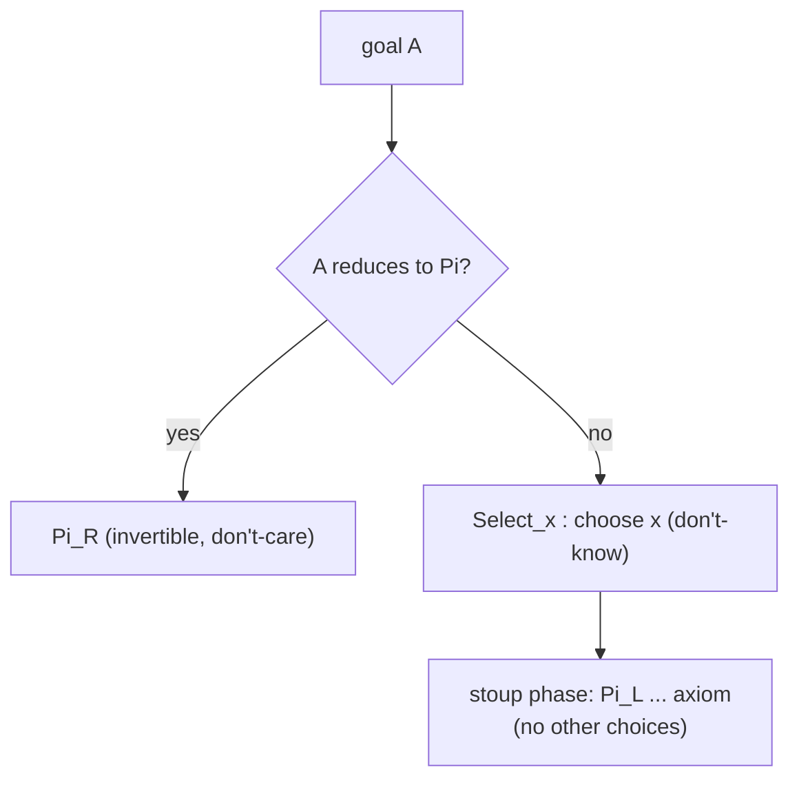

[[book-guidelines|↩ Back to guidelines]]

# Focused Sequent Calculus and Permutation-Free Proof-Search

## The problem

Searching for a proof bottom-up ("root-first") means repeatedly asking: *which rule do I apply to this goal?* In a natural-deduction calculus, elimination rules have the goal at the *bottom* but their interesting premise (the major premise) is not determined by the goal. In a Gentzen-style sequent calculus with left and right introduction rules (the paper cites G3), bottom-up search is more natural, but there is a different waste: many orders of applying rules give the *same* proof. The Introduction says these permutations "introduce some extra non-determinism in proof-search".

What breaks without a fix: the search explores the same proof many times over, and two proofs differing only in rule order are counted as different.

## The fix: Herbelin's LJT

Herbelin introduced the **permutation-free** calculus LJT for intuitionistic logic. It exploits **focusing** (Andreoli; Danos–Joinet–Schellinx; ultimately Girard's linear logic): at any moment, at most one formula in the sequent is *in focus*, and the proof must keep decomposing it until it is done. The paper stresses (Introduction):

- LJT is strongly related to natural deduction and "already well adapted to proof-search" (Dyckhoff–Pinto);
- it generalises the **uniform proofs** approach of logic programming (see Miller et al. on hereditary Harrop logic);
- with cuts and proof-terms it is an explicit-substitution calculus $\overline{\lambda}$ with a strong connection to call-by-name $\beta$-reduction and abstract machines such as Krivine's.

The distinguishing syntactic device is the **stoup**: sequents have the form

$$\Gamma;B\vdash l:C$$

where $B$ (the stoup, separated by `;`) is the single focused formula/type. Without focus, a sequent is just $\Gamma\vdash M:A$. A *list* $l$ is a sequence of arguments: the judgement says "applying something of type $B$ to the arguments $l$ gives something of type $C$". The key rule is

$$\frac{\Gamma\vdash M:A\qquad \Gamma;\langle M/x\rangle B\vdash l:C}{\Gamma;\Pi x^A.B\vdash M\cdot l:C}\ \Pi L$$

which consumes one argument and continues with a smaller stoup type.

### Rust: two judgement shapes

```rust
enum Judgement {
    /// Gamma |- M : A      (no focus: choose Select_x or Pi_R)
    Term { ctx: Ctx, term: Term, ty: Term },
    /// Gamma ; B |- l : C  (focus on stoup B)
    List { ctx: Ctx, stoup: Term, list: List, ty: Term },
}

// Search alternates: Select_x moves a variable's type into the stoup, then
// Pi_L / axiom run to completion with no other choice of focus.
```

## Why focus kills the permutations

After `Select_x` puts the type of $x$ into the stoup, the only applicable rules are $\Pi L$ (if the stoup is a $\Pi$) and `axiom` (if it matches the goal). There is no interleaving with other left rules on other hypotheses. The ordering freedom is gone.

### Lean (commentary)

Lean's `apply f` is the same pattern: pick one hypothesis `f` (Select), then peel off its binders one by one (ΠL) creating new goals, and finish by unifying the remaining type with the goal (axiom). The paper makes this analogy explicit for Coq's `apply` (see [[Proof-Search-Strategies-and-Tactics]]).

## Focused (LJT) versus unfocused (G3), and what is chosen here

The Introduction's comparison with prior work (table on p. 4):

| Work | Type theory | Rules | Terms | Incomplete proofs (meta-variables) |
|---|---|---|---|---|
| Pym | $\lambda\Pi$ | G3 | $\lambda$ | yes |
| Dowek | CoC | NJ | $\lambda$ | yes |
| Pym–Dyckhoff | $\lambda\Pi(\Sigma)$ | LJT | $\overline\lambda$ | no |
| Gutiérrez–Ruiz | PTS | G3 | $\lambda$ | no |
| Geuvers–Jojgov | $\lambda$HOL | NJ | $\lambda$ | yes |
| **This paper** | PTS | **LJT** | $\overline\lambda$ | **yes** |

The authors choose LJT because it "forces proof-search to be goal-directed in the tradition of logic programming and uniform proofs", whereas G3 "is more relaxed and would accommodate saturation-based reasoning". The motivation is also a tighter link with natural deduction and with tactics in Coq and Lego.

## Two kinds of non-determinism (§5)

After building the syntax-directed system ([[Proof-Search-System-PS]]) the paper identifies exactly where choice remains:

- **Don't-care** non-determinism: choosing among *invertible* rules; any choice is fine.
- **Don't-know** non-determinism: a choice that may be wrong and needs backtracking. The head-variable choice for `Select_x` is the main one.

The overlap between $\Pi R$ and `Select_x` (when the goal is a $\Pi$-type), and between $\Pi L$ and `axiom` (when the stoup is a $\Pi$), is removed by requiring the goal not to reduce to a $\Pi$ when selecting; this "corresponds to looking only for $\eta$-long normal forms in natural deduction" and "brings the derivations closer to the notion of uniform proofs".



## How this feeds the project

*Focus Area: `automated-reasoning` (with `type-theory`).* Concepts: focused sequent calculus, proof search, unification, proof reconstruction.

- **Design rule:** structure the prover's search as *focus phases*. The choice point is only the head variable; everything else is deterministic or invertible. In Rust this is a `fn select(&Ctx, &Goal) -> impl Iterator<Item = Var>` for the don't-know choice and plain recursion for the rest.
- **Uniform proofs** connect to the Horn-clause and logic-programming layer the compiler wants for verification conditions.
- **Soundness story:** because the rules are the typing rules read bottom-up, the output needs no re-type-check (the paper's stated advantage over many tactic engines).

## Where this leads

[[Pure-Type-Sequent-Calculi]] puts types and proof-terms in this style; [[Proof-Search-System-PS]] makes the rules syntax-directed.
