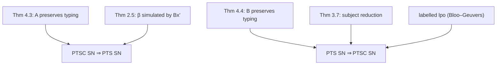

[[book-guidelines|↩ Back to guidelines]]

# Meta-Theory of PTSC

## What is being established

A new presentation of a logic is only useful if it *is* the same logic and has the same good properties. The paper proves, for any PTSC with parameters $(S,\mathcal A,\mathcal R)$ and its PTS with the same parameters:

1. Basic structural lemmas, culminating in **Subject Reduction**.
2. **Typing is preserved** by the two translations $\mathcal A$ (PTS $\to$ PTSC) and $\mathcal B$ (PTSC $\to$ PTS).
3. **The PTSC is strongly normalising iff the PTS is.**

Together these mean any PTS theorem about provability or normalisation transfers, so proof-search in the sequent calculus is search for proofs of the original system. These results were previously presented in Lengrand–Dyckhoff–McKinna 2006 and are formalised in Coq with de Bruijn indices (note on p. 5).

What breaks without this: the nice search system could be proving a different logic, or its terms could fail to normalise.

## 3. Structural properties

**Lemma 3.3 (properties of typing statements).** If $\Gamma\vdash M:A$ (resp. $\Gamma;B\vdash l:C$) then $FV(M)\subseteq Dom(\Gamma)$ (resp. $FV(l)\subseteq Dom(\Gamma)$) and the following have strictly smaller derivations: $\Gamma\ wf$; and $\Gamma\vdash A:s$ for some $s$, or $A\in S$ (resp. $\Gamma\vdash B:s$ and $\Gamma\vdash C:s'$).

**Corollary 3.4.** If $\Gamma,x{:}A,\Delta\ wf$ then $\Gamma\vdash A:s$ for some $s$, $x\notin Dom(\Gamma,\Delta)$ and $FV(A)\subseteq Dom(\Gamma)$; and $\Gamma,\Delta\ wf$ implies $\Gamma\ wf$.

**Lemma 3.5 (Weakening).** If $\Gamma,\Gamma'\ wf$ and $Dom(\Gamma')\cap Dom(\Delta)=\emptyset$ then typing under $\Gamma,\Delta$ implies typing under $\Gamma,\Gamma',\Delta$.

**Lemma 3.6 (Thinning).** If $\Gamma\sqsubseteq\Delta\ wf$ then $\Gamma\vdash M:A$ implies $\Delta\vdash M:A$ (and the same for list judgements): one can weaken, *permute* the environment and *convert* its types, provided it stays well-formed.

**Theorem 3.7 (Subject Reduction).** $\Gamma\vdash M:A$ and $M\to M'$ imply $\Gamma\vdash M':A$; and $\Gamma;B\vdash l:C$ and $l\to l'$ imply $\Gamma;B\vdash l':C$. Proved in the Appendix (using confluence from [[Operational-Semantics-and-Confluence]]).

### Rust: invariants as debug assertions

```rust
// The invariants a PTSC kernel should maintain.
fn assert_wf_invariants(g: &Ctx, m: &Term, a: &Term) {
    debug_assert!(m.free_vars().is_subset(&g.domain()));           // Lemma 3.3
    debug_assert!(g.is_well_formed());
    // Subject reduction as a property test:
    //   for any step m -> m2 with check(g, m, a) == Ok, check(g, m2, a) == Ok.
}
```

## 4.1 Type preservation: the logical correspondence

Translations are extended to environments, $\mathcal A(\emptyset)=[\,]$, $\mathcal A(\Gamma,(x{:}T))=\mathcal A(\Gamma),(x{:}\mathcal A(T))$, and likewise $\mathcal B$.

- **Corollary 4.2 (equational theories coincide):** $t\leftrightarrow^*_\beta u$ iff $\mathcal A(t)\leftrightarrow^*\mathcal A(u)$; $M\leftrightarrow^*N$ iff $\mathcal B(M)\leftrightarrow^*_\beta\mathcal B(N)$.
- **Theorem 4.3 (preservation 1, PTS $\to$ PTSC):** $\Gamma\vdash_{PTS}t:T$ implies $\mathcal A(\Gamma)\vdash\mathcal A(t):\mathcal A(T)$. Part (2) handles applications: if $t_i:\{t_{i-1}/x_{i-1}\}\cdots T_i$ and the product type is well-typed, then $\mathcal A(\Gamma);\mathcal A(\Pi x_1^{T_1}\ldots\Pi x_n^{T_n}.T)\vdash\mathcal A(t_1\dots t_n):\mathcal A(\{t_n/x_n\}\cdots T)$. Part (3): well-formedness.
- **Theorem 4.4 (preservation 2, PTSC $\to$ PTS):** $\Gamma\vdash M:A$ implies $\mathcal B(\Gamma)\vdash_{PTS}\mathcal B(M):\mathcal B(A)$; $\Gamma;B\vdash l:C$ implies $\mathcal B(\Gamma),y{:}\mathcal B(B)\vdash_{PTS}\mathcal B^y(l):\mathcal B(C)$ for fresh $y$; and well-formedness.

Both proved by induction on typing derivations. Part (2) of 4.3 is the sequent-calculus reading of "an application is a head applied to an argument list, with each argument's type depending on earlier arguments".

## 4.2 Equivalence of strong normalisation (Theorem 4.5)

> A PTSC with sets $S,\mathcal A,\mathcal R$ is strongly normalising iff the corresponding PTS is.

**($\Rightarrow$)** Assume the PTSC is SN. For a typable $t$ in the PTS, $\mathcal A(t)$ is typable by Theorem 4.3 hence SN. By Theorem 2.5, every reduction sequence from $t$ maps to one at least as long from $\mathcal A(t)$; those are finite.

**($\Leftarrow$)** Assume the PTS is SN and $\Gamma\vdash M:A$ in the PTSC. By subject reduction every reduct $N$ is typable, and so is every sub-term/sub-list. By Theorem 4.4 their images under $\mathcal B$ are typable in the PTS, hence SN. Then the termination of x$'$ is *refined* by the technique of Bloo and Geuvers: label $cut$ and $sub$ symbols with the (strongly normalising) PTS terms they translate to, giving an infinite signature (Fig. 8) with precedence

$$\star\prec i\prec ii\prec cut_t\prec sub_t,\qquad sub_{t'}\prec cut_t\ \text{whenever}\ t'\to^+_\beta t.$$

This precedence is still well-founded, so the induced lpo is too, and an induction on terms shows every reduction decreases the lpo.

Consequence stated in the paper: the Calculus of Constructions (on which Coq is based, minus inductive types and local definitions) and the other systems of the cube are SN, so "for all of which we now have a corresponding PTSC that can be used for proof-search".



## How this feeds the project

*Focus Area: `type-theory`.* Concepts: judgments, contexts, definitional equality, trusted kernel, soundness.

- **Load-bearing:** subject reduction and thinning are exactly what a Rust kernel's correctness argument rests on; the PTS/PTSC equivalence supports a design where the *search* operates in the sequent calculus and the *trusted kernel* checks the result as an ordinary PTS term, with Theorems 4.3/4.4 as the interface lemma.
- **Metatheory as a test plan:** weakening, thinning and subject reduction translate into property tests for any implementation.
- The SN argument via a labelled lpo is a reusable technique for proving termination of an explicit-substitution evaluator.

## Where this leads

[[Proof-Search-System-PS]] and [[Proof-Enumeration-System-PE]] build on this: their soundness is stated in terms of PTSC typing and, by this note, therefore PTS provability.
