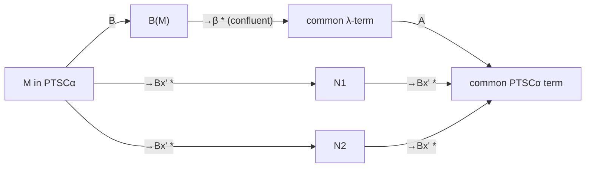

[[book-guidelines|↩ Back to guidelines]]

# Operational Semantics and Confluence

## What needs defining

PTSC terms are built from heads, argument lists and explicit substitutions. Computation is *cut elimination*: local rewrite rules that push cuts (applications and substitutions) inward until none remain. The paper must (a) give those rules, (b) show a sub-system always terminates, and (c) show the whole system is **confluent**, so normal forms are unique and conversion is well-defined. This also covers the meta-variable extension: meta-variables behave like constants during reduction.

## The rewrite rules (Fig. 1)

Rule **B** is $\beta$-reduction in sequent form; the rest are bookkeeping.

$$\textbf{B}:\ (\lambda x^A.M)\,(N\cdot l)\to(\langle N/x\rangle M)\,l$$

| Group | Rules |
|---|---|
| B1–B3 | $M\,[\,]\to M$; $(x\,l)\,l'\to x\,(l@l')$; $(M\,l)\,l'\to M\,(l@l')$ |
| A1–A4 (append) | $(M\cdot l')@l\to M\cdot(l'@l)$; $[\,]@l\to l$; $(l@l')@l''\to l@(l'@l'')$; $l@[\,]\to l$ |
| C1–C6 (substitution into terms) | $\langle P/y\rangle\lambda x^A.M\to\lambda x^{\langle P/y\rangle A}.\langle P/y\rangle M$; $\langle P/y\rangle(y\,l)\to P\,\langle P/y\rangle l$; $\langle P/y\rangle(x\,l)\to x\,\langle P/y\rangle l$ for $x\ne y$; $\langle P/y\rangle(M\,l)\to\langle P/y\rangle M\ \langle P/y\rangle l$; $\langle P/y\rangle\Pi x^A.B\to\Pi x^{\langle P/y\rangle A}.\langle P/y\rangle B$; $\langle P/y\rangle s\to s$ |
| D1–D3 (substitution into lists) | $\langle P/y\rangle[\,]\to[\,]$; $\langle P/y\rangle(M\cdot l)\to\langle P/y\rangle M\cdot\langle P/y\rangle l$; $\langle P/y\rangle(l@l')\to\langle P/y\rangle l@\langle P/y\rangle l'$ |
| $C\alpha$, $D\beta$ | $\langle P/y\rangle\alpha(M_1..M_n)\to\alpha(\langle P/y\rangle M_1..\langle P/y\rangle M_n)$, and the same for $\beta$ |

The paper names the sub-systems **B**, **x$'$** and **xsubst$'$** (the last being the part that propagates substitutions, including $C\alpha$, D1–D3, $D\beta$), and writes **$Bx'$** for B together with x$'$. The distinction used throughout: x$'$ is terminating on **all terms, typed or not**, while adding B is terminating only on terms typed in a normalising system.

> **Reading note.** The text extraction of Fig. 1 loses the brace grouping, so I cannot state from the extracted text exactly which of B1–B3, A1–A4 and C1–C6 belong to x$'$ versus xsubst$'$. Check the figure on p. 7 before relying on a precise partition.

### Rust: a one-step reducer for the core rules

```rust
fn step_head(m: &Term) -> Option<Term> {
    match m {
        // B: (lambda x^A. M) (N . l)  -->  (<N/x> M) l
        Term::TermApp(f, l) => match (&**f, &**l) {
            (Term::Lam(_, body), List::Cons(n, rest)) =>
                Some(Term::TermApp(
                    Box::new(Term::Subst(body.clone(), BoundVar0, n.clone())),
                    rest.clone())),
            // B1: M []  -->  M
            (_, List::Nil) => Some((**f).clone()),
            // B3: (M l) l'  -->  M (l @ l')
            (Term::TermApp(g, l1), _) =>
                Some(Term::TermApp(g.clone(), Box::new(List::Append(l1.clone(), l.clone())))),
            _ => None,
        },
        _ => None,
    }
}
```

## Termination of x$'$ (Theorem 1.2, Corollary 1.3)

Encode each term/list $M$ into a first-order term $S(M)$ over the signature $\{\star/0,\ i/1,\ ii/2,\ cut/2,\ sub/2\}\cup\{tuple_n/n\}$ (Fig. 2), for example $S(\lambda x^A.M)=ii(S(A),S(M))$, $S(x\,l)=i(S(l))$, $S(M\,l)=cut(S(M),S(l))$, $S(\langle M/x\rangle N)=sub(S(M),S(N))$, $S(\alpha(M_1..M_n))=tuple_n(S(M_1),..,S(M_n))$. Equip it with the well-founded precedence

$$\star\prec i\prec ii\prec tuple_0\prec tuple_1\prec\cdots\prec cut\prec sub.$$

The induced **lexicographic path ordering** (lpo) decreases along every x$'$ step ($M\to_{x'}M'$ implies $S(M)>_{lpo}S(M')$), so **x$'$ is terminating**. This is the standard way to prove termination of explicit-substitution systems: orient each rule as a decreasing lpo step.

## Confluence by simulation (§2)

Direct critical-pair analysis is avoided. Instead: translate to ordinary $\lambda$-terms (confluent for $\beta$), transfer the reductions, and translate back.

1. **PTS$\alpha$**: the fragment of PTS terms where each reserved variable $\alpha^k$ (resp. $\beta^k$) standing for a meta-variable is never bound and is applied to at least $k$ (resp. $k+1$) arguments. It is stable under $\beta$, hence confluent (Remark 2.1).
2. **$\mathcal B$** (Fig. 3) maps PTSC$\alpha$ to PTS$\alpha$ (sequent calculus $\to$ $\lambda$-terms): e.g. $\mathcal B(x\,l)=\{x/z\}\mathcal B^z(l)$, $\mathcal B^y([\,])=y$, $\mathcal B^y(M\cdot l)=\mathcal B^{z}(l)\{y\,\mathcal B(M)/z\}$ for fresh $z$ (a list is translated relative to the head it will be applied to). List meta-variables get the future head as an extra first argument: $\mathcal B^y(\beta(M_1..M_n))=\beta^n\,y\,\mathcal B(M_1)\dots\mathcal B(M_n)$. This is why $\beta^k$ takes $k+1$ arguments.
3. **$\mathcal A$** (Fig. 4) is the way back: the Prawitz-style translation from natural deduction to sequent calculus, using a list-parameterised version $\mathcal A_l(t)$ that accumulates arguments ($\mathcal A_l(t\,u)=\mathcal A_{\mathcal A(u)\cdot l}(t)$). Well-foundedness uses **list-needing terms** (Def. 2.3): $\mathcal A_l(t)$ is defined before $\mathcal A(t)$ when $t$ needs $l$.
4. **Results.** Lemma 2.4 (the translations produce x$'$-normal forms and commute with append/substitution); **Theorem 2.2**: $\to_\beta$ simulates $\to_{Bx'}$ through $\mathcal B$; **Theorem 2.5**: $\to_{Bx'}$ strongly simulates $\to_\beta$ through $\mathcal A$; **Theorem 2.7**: $\mathcal B(\mathcal A(t))=t$ and $M\to^*_{x'}\mathcal A(\mathcal B(M))$; **Corollary 2.9**: $\to_{x'}$ and $\to_{Bx'}$ are confluent.



The proof of confluence is independent of typing (the paper notes subject reduction in the Appendix actually *uses* confluence).

## CRS-style meta-variables and the critical pair

With ERS-style meta-variables (those in Muñoz) the critical pair between B and C4 gives $\langle N/x\rangle\langle P/y\rangle M$ versus $\langle\langle N/x\rangle P/y\rangle\langle N/x\rangle M$, which need not have a common reduct. With the paper's CRS-style meta-variables (an arity, explicitly listing the variables that may occur free) the rules $C\alpha$ and $D\beta$ close it. Likewise, the critical pair of B3 with itself (or B2) needs A3 to close, which was "only there for convenience" for ground terms.

### Python: what "confluent by simulation" asks you to test

```python
def check_confluence(t, reduce_all):
    # property-test: any two reduction sequences from t can be rejoined
    a, b = random_reduct(t), random_reduct(t)
    return normal_form(a) == normal_form(b)      # if terminating (typed terms)
```

*(A testing sketch; the paper's argument is a proof, not a test.)*

## How this feeds the project

*Focus Area: `type-theory`.* Concepts: operational semantics, definitional equality, substitution, variable capture.

- **Load-bearing for `isDefEq`:** conversion $\leftrightarrow^*_{Bx'}$ is only a decision-friendly equality because reduction is confluent and (on typed terms) terminating. The same two properties must hold for the Rust kernel's reduction relation.
- **Explicit substitutions** make substitution a *first-class, delayed* operation, the same trade as a Rust kernel's closure/environment-based evaluator versus eager substitution.
- **Meta-variables in a rewriting system:** treating them as constants of fixed arity during reduction (no instantiation mid-computation) is a clean design rule for an elaborator's normaliser.

## Where this leads

[[Meta-Theory-of-PTSC]] uses confluence for subject reduction; [[Meta-Variables-and-Partial-Proof-Terms]] explains the arity-annotated meta-variables used here.
