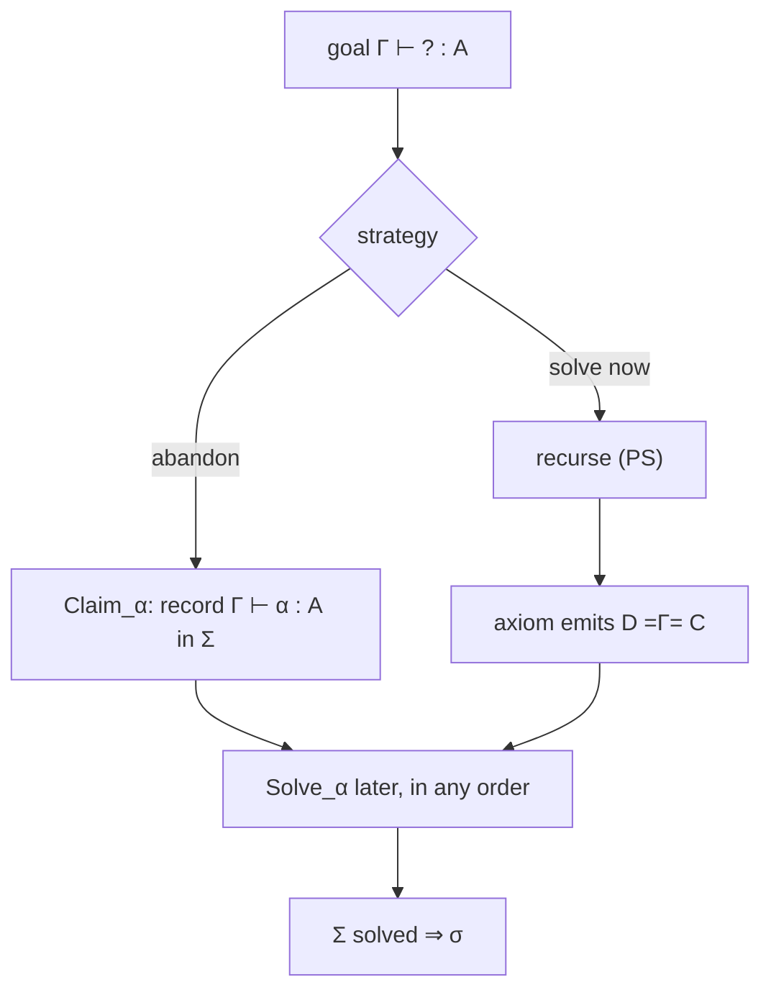

[[book-guidelines|↩ Back to guidelines]]

# Proof Enumeration System PE

## The idea

PS ([[Proof-Search-System-PS]]) must solve each sub-goal as soon as it is created. PE extends PS to **open terms** so that a sub-goal can be **abandoned (claimed) and recorded for later**, together with the **unification constraints** produced along the way. Each PE statement carries an output goal environment $\Sigma$:

$$\Gamma\vdash_{PE}M:A\mid\Sigma\qquad\Gamma;B\vdash_{PE}l:C\mid\Sigma\qquad\Sigma\Longrightarrow_{PE}\sigma$$

The first two have the same intuitive meaning as the PS statements plus the remaining sub-goals and constraints. Inputs: $\Gamma,A$ (and $\Gamma,B,C$); outputs: the term/list and $\Sigma$. PS statements are the special case with $\Sigma$ always solved. The third form, $\Sigma\Longrightarrow\sigma$, takes a goal environment as input and outputs its solution $\sigma$.

What breaks without PE: in $\Pi L$ the first premise is chosen blindly; if it is wrong the second premise fails, forcing backtracking over all proof-terms for the first. With PE, one proves the second premise first, using the constraint that falls out to pin down the first.

## Rules (Fig. 10)

Claiming a goal (abandoning it, recording it):

$$\frac{\Gamma=x_1{:}A_1,\dots,x_n{:}A_n}{\Gamma\vdash_{PE}\alpha(x_1[\,],..,x_n[\,]):C\mid(\Gamma\vdash\alpha:C)}\ Claim_\alpha\qquad \frac{\Gamma=x_1{:}A_1,\dots,x_n{:}A_n}{\Gamma;D\vdash_{PE}\beta(x_1[\,],..,x_n[\,]):C\mid(\Gamma;D\vdash\beta:C)}\ Claim_\beta$$

The axiom now **emits a constraint** instead of checking convertibility:

$$\frac{}{\Gamma;D\vdash_{PE}[\,]:C\mid D\overset{\Gamma}{=}C}\ axiom$$

$\Pi L$ in PE collects both premises' goal environments, and the dependent premise's type can mention a meta-variable:

$$\frac{D\to^*_{Bx}\Pi x^A.B\quad \Gamma\vdash_{PE}M:A\mid\Sigma_1\quad \Gamma;\langle M/x\rangle B\vdash_{PE}l:C\mid\Sigma_2}{\Gamma;D\vdash_{PE}M\cdot l:C\mid\Sigma_1,\Sigma_2}\ \Pi L$$

The remaining rules (sorted, $\Pi wf$, $Select_x$, $\Pi R$) are the PS rules threaded with $\Sigma$. Three rules on the third kind of statement drive solving:

$$\frac{\Gamma;B\vdash_{PE}l:C\mid\Sigma''\quad \Sigma,\Sigma'',(\beta\mapsto Dom(\Gamma).l)(\Sigma')\Longrightarrow\sigma_\Sigma,\sigma_{\Sigma''},\sigma_{\Sigma'}}{\Sigma,(\Gamma;B\vdash\beta:C),\Sigma'\Longrightarrow\sigma_\Sigma,\ (\beta\mapsto Dom(\Gamma).(\sigma_\Sigma,\sigma_{\Sigma''})(l)),\ \sigma_{\Sigma'}}\ Solve_\beta$$

$Solve_\alpha$ is the same for term goals, and $\dfrac{\Sigma\text{ solved}}{\Sigma\Longrightarrow\emptyset}$ (Solved) ends the process. Any goal in $\Sigma$ may be selected next: **the order is not fixed**.

### Rust

```rust
struct Sigma { goals: Vec<Goal>, constraints: Vec<Constraint> }
enum Goal { Term { g: Ctx, meta: MetaId, ty: Term },
            List { g: Ctx, stoup: Term, meta: MetaId, ty: Term } }

// ΠL in PE: claim the first premise, continue with the second.
fn pi_l(g: &Ctx, stoup: &Term, goal: &Term, fresh: &mut Fresh) -> (List, Sigma) {
    let Term::Pi(a, b) = whnf(stoup) else { unreachable!() };
    let alpha = fresh.term_meta();
    let m = claim(g, alpha);                               // Claim_alpha
    let mut sg = Sigma::from_goal(Goal::Term { g: g.clone(), meta: alpha, ty: (*a).clone() });
    let (rest, sg2) = search_list_pe(g, &subst(&b, &m), goal, fresh);
    sg.extend(sg2);
    (List::Cons(Box::new(m), Box::new(rest)), sg)
}
// axiom in PE: emit the constraint stoup =_Γ goal instead of checking it.
fn axiom_pe(g: &Ctx, stoup: &Term, goal: &Term) -> (List, Sigma) {
    (List::Nil, Sigma::constraint(g.clone(), stoup.clone(), goal.clone()))
}
```

## Soundness and completeness

**Definition 6.3 (Solution).** $\sigma$ is a solution of $\Sigma$ by induction on its length: of $\emptyset$; of $\Sigma,(x_1{:}A_1..x_n{:}A_n\vdash\alpha:C)$ if $x_1{:}\sigma(A_1),..\vdash_{PS}(\sigma(\alpha))(x_1[\,],..,x_n[\,]):\sigma(C)$ (and the list version); of $\Sigma,(D\overset{\Gamma}{=}C)$ if $\sigma(D)\leftrightarrow^*\sigma(C)$. So a solution must turn each goal into an actual PS-derivation and each constraint into convertibility.

**Lemma 6.4.** If $\sigma(M)$ and $\sigma(l)$ are ground, reductions commute with $\sigma$ ($M\to_{Bx'}N$ implies $\sigma(M)\to^*_{Bx}\sigma(N)$).

**Theorem 6.5 (Soundness).** If $\sigma$ solves $\Sigma$: $\Gamma\vdash_{PE}M:A\mid\Sigma$ implies $\sigma(\Gamma)\vdash_{PS}\sigma(M):\sigma(A)$, and likewise for lists. **Corollary 6.6:** $\Sigma\Longrightarrow_{PE}\sigma$ implies $\sigma$ solves $\Sigma$.

**Theorem 6.7 (Completeness).** $\Gamma\vdash_{PS}M:A$ implies $\Gamma\vdash_{PE}M:A\mid\Sigma$ for some solved $\Sigma$; likewise for lists. "By induction on derivations. The rules of PE generalise those of PS." The paper remarks this is unsurprising since PE says nothing about *when to abandon a goal*; the interesting statements are about completeness of particular strategies ([[Proof-Search-Strategies-and-Tactics]]).



## Avoiding $r$-splitting

Compared with Dowek's natural-deduction-based algorithm, the paper claims two novelties (§6):

1. **The search tree is made of sequent-calculus rules**; exploring it is merely root-first construction of a derivation tree, which "greatly simplifies the understanding and the description" of the algorithms.
2. **No $r$-splitting.** In natural deduction, lists of arguments are not first-class: choosing a head variable means anticipating the number of arguments (infinitely many with polymorphism), which requires analysing sorting relations in a single search step and yields an infinitely branching tree needing interleaving. With **list meta-variables of unknown length** the head is chosen without committing to the argument count.

## How this feeds the project

*Focus Areas: `automated-reasoning`, `type-theory`.* Concepts: metavariables, unification, constraint generation, proof reconstruction, proof certificates.

- **Load-bearing:** the contract of Theorem 6.5 (a solution to the pending goals yields a PS derivation) is the invariant an elaborator's final "all goals solved and constraints satisfied" check enforces. The `Sigma` struct above is the data model.
- **Order-free goal solving** is a performance lever: with dependency-aware goal selection (don't solve $\alpha'$ before its type's meta-variable is known; see the worked example) you avoid blind guessing.
- The completeness proof being easy is a design lesson: make the rule system *general* and put strategy in a separate layer.

## Where this leads

[[Unification-and-Type-Inhabitation]] shows PE as a unification algorithm framework; [[Proof-Search-Strategies-and-Tactics]] studies strategies over PE; [[Worked-Example-in-System-F]] runs it.
