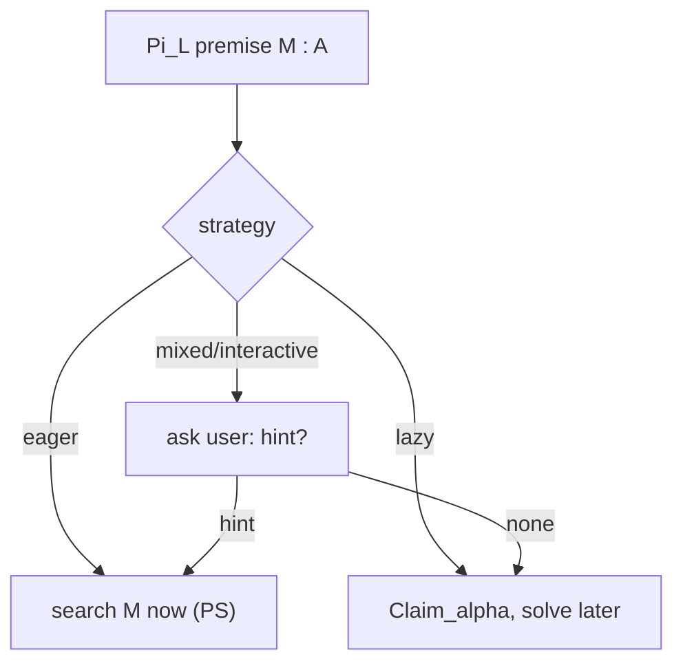

[[book-guidelines|↩ Back to guidelines]]

# Proof-Search Strategies and Tactics

## The gap the paper closes

Proof assistants such as Coq and Lego are built on PTS-style logics presented in natural deduction, but their *tactics* do not correspond one-to-one to the natural-deduction rules. The Introduction (citing McKinna's work) observes:

- `intro` corresponds to the right introduction rule $\Pi R$ (the same in natural deduction and sequent calculus);
- `apply` in Coq and `Refine` in Lego are "much closer (in spirit) to the left-introduction rule $\Pi L$ in the focused sequent calculus LJT than to the $\Pi$-elimination rule in natural deduction".

So the "usual gap (particularly wide for PTS and their implementations) between the rules defining a logic and the rules describing proof-search steps" is bridged by taking the sequent calculus as the logic. A by-product: correctness of search by construction.

What breaks otherwise: tactic implementations are trusted code whose output is re-checked by the kernel, and the relationship between tactic behaviour and the logic is informal.

## `apply x` decomposed

In §5 the authors decompose Coq's `apply x` as: bottom-up `Select_x`, then a series of bottom-up $\Pi L$ steps, then `axiom`. In plain Coq, `apply` either postpones the sub-goals or solves them automatically from the unification attempt, "often avoiding obvious back-tracking". Which sub-goals get solved automatically? Those that "interfere with the unification constraint"; the others are left for later and visible to the user. If unification fails, the user can still give an explicit proof-term, but in proof-*synthesis* mode Coq requires it to be given fully (the tactic fails if unification fails). In PE "the unification constraint can remain partially solved".

```
apply x  ≈  Select_x ; Pi_L ; Pi_L ; ... ; axiom
              pick     one per      emit constraint
              head     argument     (solve or leave sub-goals)
```

### Lean

```lean
example (p q r : Prop) (hpq : p → q) (hqr : q → r) (hp : p) : r := by
  apply hqr        -- Select hqr, Pi_L once, axiom: goal r unified with hqr's result
  -- new goal: q   (the claimed premise, postponed)
  apply hpq        -- next goal: p
  exact hp
```

Each `apply` here is the PE pattern: select, claim the premise, let the conclusion constraint decide.

## The strategies PE can express (§6)

PE says nothing about *when to abandon a goal and start another*, so it is a **framework for studying strategies**. The paper lists three, as completeness questions:

| Strategy | Behaviour | Where it appears |
|---|---|---|
| **Eager** | solve every sub-goal as soon as it is created, never delaying | PS |
| **Lazy** | always abandon the sub-goal generated by $\Pi L$ | Dowek's proof enumeration [Dow93] |
| **Mixed** | delay selectively; consult the user on $\Pi L$'s first premise | interactive provers |

Observations from the paper:

- Laziness lets unification constraints guide the solution of the delayed sub-goal later, so it is "probably more efficient than eagerness"; "this is probably what should be chosen for automated theorem proving".
- For interactive proving, rule $\Pi L$ is "a good place to ask whether the user has any clue to solve the sub-goal (since it could help solving the rest of the unification). If he or she has none, then by default the algorithm might abandon the sub-goal and leave it for later."
- Completeness of the *full* PE is not interesting (it is general); interesting are completeness results for particular strategies. These are left open.



### Rust: strategy as a trait over PE

```rust
trait Strategy {
    /// Decide what to do with the first premise of Pi_L.
    fn on_pi_l(&mut self, g: &Ctx, premise: &Term) -> Decision;
    /// Choose the next pending goal to work on.
    fn pick_goal(&mut self, sigma: &Sigma) -> Option<GoalId>;
}
enum Decision { SolveNow, Claim, AskUser }

struct Eager;  struct Lazy;
impl Strategy for Eager { fn on_pi_l(&mut self, _: &Ctx, _: &Term) -> Decision { Decision::SolveNow }
                          fn pick_goal(&mut self, s: &Sigma) -> Option<GoalId> { s.first() } }
impl Strategy for Lazy  { fn on_pi_l(&mut self, _: &Ctx, _: &Term) -> Decision { Decision::Claim }
                          fn pick_goal(&mut self, s: &Sigma) -> Option<GoalId> { s.most_constrained() } }
```

*Author's sketch.* The point it makes is architectural: PE fixes the legal moves, a `Strategy` chooses among them, and soundness (Theorem 6.5) holds for every strategy.

## Related formalisations of incomplete proofs

The Introduction mentions work that also formalises partial proofs and tactic languages: Delahaye's $\mathcal L_{tac}$ and $\mathcal L_{pdt}$; McBride's and Jojgov's PhD theses, which extend type theory with partial proof objects (Jojgov manages progressive instantiation of meta-variables via a definitional mechanism and compares it with Delahaye); and Geuvers–Jojgov on open proofs and open terms. Formalising the connection is explicitly left as future work.

## Further work relevant to tactics (Conclusion)

- Ongoing: incorporate these ideas into the redesign of the Coq proof engine, and treat $\eta$-conversion (currently missing in PTS-based Coq), expected to connect the approach to uniform proofs in logic programming.
- Later: direct strong-normalisation proofs; inductive types and their specific tactics "should also clearly appear in sequent calculus"; classical [[Pure-Type-Sequent-Calculi|Pure Type Sequent Calculi]].

## How this feeds the project

*Focus Areas: `automated-reasoning`, `type-theory`.* Concepts: proof search, proof reconstruction, trusted kernels, unification, elaboration.

- **Mechanism, not theory:** the project's theorem prover embedded in the toolchain should expose exactly this separation: a small set of sound PE moves, plus replaceable strategies. Soundness is independent of strategy, so heuristics can be tuned (or learned) without touching the trusted base.
- **Lazy by default for automation, eager for determinism:** the paper's remark about which is likely best gives a defensible default; the project can test it empirically by swapping `Strategy` implementations.
- **Interactive hooks:** `AskUser` at $\Pi L$ is a specification for where a counterexample-guided or abduction-based hint (an invariant, a lemma) should enter.

## Where this leads

[[Worked-Example-in-System-F]] shows the lazy strategy end to end; [[Proof-Enumeration-System-PE]] gives the rules the strategies act on.
