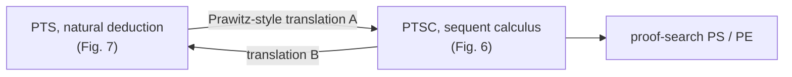

[[book-guidelines|↩ Back to guidelines]]

# Pure Type Systems and the Lambda Cube

## Why PTS are the right target

System F, System F$\omega$, $\lambda\Pi$ and the Calculus of Constructions all extend the simply typed $\lambda$-calculus, but differently. A **Pure Type System** (PTS), introduced independently by Berardi and Terlouw as a generalisation of Barendregt's $\lambda$-cube, expresses all of them with one set of rules and a small parameter table. The paper's Introduction lists the payoff: several major proof assistants are based on such systems (Coq, Lego, the Edinburgh Logical Framework), and Higher-Order Logic can be presented as a PTS, even though its main implementation does not use that presentation.

For this paper the point is practical: if proof-search is defined *once, parametrically*, it covers every corner of the cube and the systems behind real provers.

What breaks otherwise: a search procedure designed for one calculus (say $\lambda\Pi$, as in Pym–Wallen) has to be re-derived for each other calculus.

## The parameters and the natural-deduction rules (Fig. 7, p. 15)

A PTS is given by sorts $S$, axioms $\mathcal A\subseteq S^2$ and rules $\mathcal R\subseteq S^3$. Terms:

$$t,u,v,T,U,V ::= x \mid s \mid \Pi x^T.t \mid \lambda x^T.t \mid t\,u$$

with the single reduction rule $(\lambda x^v.t)\,u\to_\beta \{u/x\}t$ (implicit substitution, a meta-operation).

Typing (Fig. 7), in natural-deduction style:

$$\frac{\Gamma\vdash_{PTS}U:s_1\quad \Gamma,(x{:}U)\vdash_{PTS}T:s_2\quad (s_1,s_2,s_3)\in\mathcal R}{\Gamma\vdash_{PTS}\Pi x^U.T:s_3}\qquad \frac{\Gamma\vdash t:\Pi x^U.T\quad \Gamma\vdash u:U}{\Gamma\vdash t\,u:\{u/x\}T}$$

plus the rules for the empty environment, extension, variables, sorts $\Gamma\vdash s:s'$ for $(s,s')\in\mathcal A$, $\lambda$-abstraction, and **conversion**: $\Gamma\vdash t:U$, $\Gamma\vdash V:s$ and $U\leftrightarrow^*_\beta V$ give $\Gamma\vdash t:V$.

Classical metatheory (Theorem 4.1, citing Barendregt): thinning ($\Gamma\sqsubseteq\Delta$ wf transfers typing), substitution, and subject reduction ($\Gamma\vdash t:T$, $t\to_\beta u$ implies $\Gamma\vdash u:T$).

### Rust

```rust
#[derive(Clone, PartialEq)]
enum Term {
    Sort(Sort),
    Var(usize),
    Pi(Box<Term>, Box<Term>),      // Pi x^A . B
    Lam(Box<Term>, Box<Term>),     // lambda x^A . M
    App(Box<Term>, Box<Term>),     // t u
}

struct Pts { sorts: Vec<Sort>, axioms: Vec<(Sort, Sort)>, rules: Vec<(Sort, Sort, Sort)> }

fn infer(pts: &Pts, ctx: &Ctx, t: &Term) -> Result<Term, TypeError> {
    match t {
        Term::Sort(s) => pts.axiom(*s).map(Term::Sort).ok_or(TypeError::NoAxiom),
        Term::Var(i)  => Ok(ctx.lookup(*i).clone()),
        Term::Pi(a, b) => {
            let s1 = infer(pts, ctx, a)?.as_sort()?;
            let s2 = infer(pts, &ctx.extend(a), b)?.as_sort()?;
            pts.rule(s1, s2).map(Term::Sort).ok_or(TypeError::NoRule)
        }
        Term::App(f, u) => {
            let Term::Pi(a, b) = whnf(&infer(pts, ctx, f)?) else { return Err(TypeError::NotPi) };
            check(pts, ctx, u, &a)?;              // conversion happens in `check`
            Ok(subst(&b, u))
        }
        Term::Lam(..) => todo!(), // needs Pi-formation check, then body inference
    }
}
```

## The cube and strong normalisation (§4.2)

The paper does not re-derive the cube; it fixes parameters $(S,\mathcal A,\mathcal R)$ and states results for *any* PTS. Its System F example (§7) uses

$$S=\{\star,\square\},\quad \mathcal A=\{(\star,\square)\},\quad \mathcal R=\{(\star,\star),(\square,\star)\}.$$

Theorem 4.5 relates normalisation of the sequent calculus to that of the PTS (see [[Meta-Theory-of-PTSC]]); the paper notes the Calculus of Constructions, and the other systems of the cube, are strongly normalising, so each corner of the cube has a PTSC usable for proof-search. (Coq's additional inductive types and local definitions are outside this paper's scope; the Conclusion lists inductive types as further work.)

### Lean

```lean
-- Conversion rule in action: the types are equal up to beta/delta, so no coercion is needed.
def Vec (α : Type) (n : Nat) := { l : List α // l.length = n }
example (v : Vec Nat (1+1)) : Vec Nat 2 := v
```

Lean is not literally a PTS (impredicative `Prop`, a universe hierarchy, inductive types), but its kernel's $\Pi$-formation and application rules are recognisably Fig. 7. *Author's commentary.*

## Natural deduction as the place proof-search is awkward

The Introduction says: with typed $\lambda$-calculus as basis, PTS are "traditionally presented in natural deduction style, with rules introducing and eliminating logical constants". Dowek (1993) and Muñoz (2001) do proof-search in this style by *enumerating type inhabitants*. The paper's complaint is that this "misses out on the advantages of sequent calculus for proof-search" (see [[Focused-Sequent-Calculus-and-Permutation-Free-Proof-Search]]). The elimination rule searched bottom-up requires guessing the head variable and the number of arguments ahead of time, which is where Dowek's $r$-splitting comes from.



## How this feeds the project

*Focus Area: `type-theory`.* Concepts: judgments, contexts, dependent types, $\Pi$-types, definitional equality, bidirectional typing.

- **Load-bearing:** the PTS parameter table is a clean way to parameterise the Rust kernel over the sort/axiom/rule structure, and Fig. 7 is the rulebook the kernel's `isDefEq` plus `infer`/`check` implements. Inference for $\Pi$-formation and application is the synthesis mode; the conversion rule is the point where checking mode calls definitional equality (a bidirectional reading, not the paper's wording).
- The paper's later claim that PTSC and PTS are interchangeable means proof-search can be designed in the sequent style while the *kernel* stays a standard PTS checker.

## Where this leads

[[Pure-Type-Sequent-Calculi]] gives the sequent-calculus presentation of the same logics, and [[Meta-Theory-of-PTSC]] proves the two equivalent.
