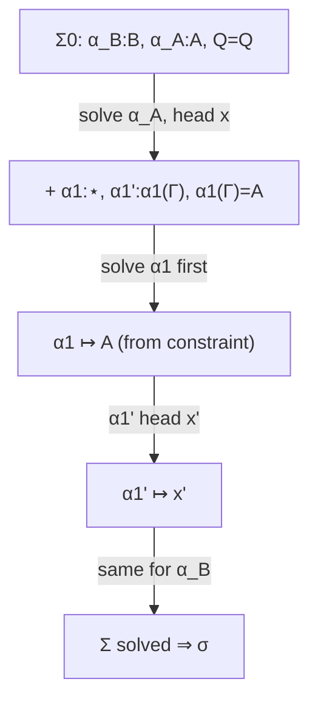

[[book-guidelines|↩ Back to guidelines]]

# Worked Example in System F: Commutativity of Conjunction

## The setting

System F as a PTS: $S=\{\star,\square\}$, $\mathcal A=\{(\star,\square)\}$, $\mathcal R=\{(\star,\star),(\square,\star)\}$. For readability the paper omits types on $\lambda$-abstractions, writes $x$ for $x\,[\,]$, simplifies $\langle N/x\rangle P$ to $P$ when $x\notin FV(P)$, and writes conjunction in its System F encoding:

$$A\wedge B\ :=\ \Pi Q^{\star}.(A\to(B\to Q))\to Q.$$

**Goal:** inhabit $(A\wedge B)\to(B\wedge A)$ in the environment $A:\star,\ B:\star$.

The conjunction has no constructor or projections: an inhabitant $x:A\wedge B$ is used by *applying it to a type and a continuation*. To extract $A$, apply $x$ to $A$ and the continuation $\lambda x'y'.x'$.

## Search in PS (Fig. 9)

Environment $\Gamma=A{:}\star,B{:}\star,x{:}A\wedge B,Q{:}\star,y{:}B\to(A\to Q)$. After $\Pi R$ three times, choose head $y$ (`Select_y`) with stoup $B\to(A\to Q)$; $\Pi L$ twice generates two sub-goals in order:

```
Γ ⊢ N_B : B     Γ ⊢ N_A : A       Γ; Q ⊢ [] : Q   (axiom)
```

with answers $N_A=x\,A\cdot(\lambda x'.\lambda y'.x')\cdot[\,]$ and $N_B=x\,B\cdot(\lambda x'.\lambda y'.y')\cdot[\,]$, for the final proof

$$\lambda x.\lambda Q.\lambda y.\ y\ N_B\cdot N_A\cdot[\,].$$

Each of $\pi_A,\pi_B$ is itself a PS derivation: pick $x$, apply $\Pi L$ to the type argument $A$ (itself a sub-search that inhabits the *sort* $\star$ by `Select_A`), then to the continuation $A\to(B\to A)$, then axiom.

**The problem in PS** (stated by the authors): "the need for delaying the search for a proof of the first premiss of rule $\Pi L$". In $\pi_A$, the first $\Pi L$ premise asks for a type $H:\star$ to apply $x$ to. Without further information the search "has to guess in advance, anticipating the implicit constraints that such a choice will have to satisfy" — hardly mechanisable, leading to "numerous backtrackings".

## Search in PE (Fig. 10)

Notation: $\Gamma=A{:}\star,B{:}\star,x{:}A\wedge B,Q{:}\star,y{:}B{\to}A{\to}Q$; $\alpha_A(\Gamma)=\alpha_A(A,B,x,Q,y)$, $\alpha_B(\Gamma)=\alpha_B(A,B,x,Q,y)$.

$$M'=\lambda x.\lambda Q.\lambda y.\ y\ \alpha_B(\Gamma)\cdot\alpha_A(\Gamma)\cdot[\,],\qquad \Sigma=(\Gamma\vdash\alpha_B:B),\ (\Gamma\vdash\alpha_A:A),\ (Q\overset{\Gamma}{=}Q).$$

**Phase 1: the skeleton.** Every $\Pi L$ premise is claimed (`Claim`) and recorded in $\Sigma$. The *only* commitment is the head variable $y$, "because it led to the production of the (solved) unification constraint $Q\overset{\Gamma}{=}Q$". So

$$A{:}\star,B{:}\star\vdash_{PE}M':(A\wedge B)\to(B\wedge A)\mid\Sigma,\qquad \Sigma\Longrightarrow\sigma_\Sigma.$$

**Phase 2: solve $\alpha_A$.** Choose head $x$ (the only sensible one, again decided by constraint). $\Pi L$ twice yields new claims:

- $\Gamma\vdash\alpha_1:\star$ with $\Sigma_1=(\Gamma\vdash\alpha_1:\star)$, the type to apply $x$ to;
- $\Gamma'\vdash\alpha_1':\alpha_1(\Gamma)$ with $\Gamma'=\Gamma,x'{:}A,y'{:}B$, for the continuation body, under the binders $\lambda x'y'$;
- and the axiom's constraint $\alpha_1(\Gamma)\overset{\Gamma}{=}A$ (the result of the continuation must be $A$).

"Any other choice of head-variable would have led to a unification constraint with no solution. Here, this fact (and the subsequent choice of $x$) can be mechanically noticed by a simple syntactic check."

**Phase 3: order matters.** Three goals remain: $\alpha_B$, $\alpha_1:\star$, and $\alpha_1':\alpha_1(\Gamma)$. "Clearly we cannot solve $(\Gamma'\vdash\alpha_1':\alpha_1(\Gamma))$ before we know $\alpha_1(\Gamma)$." So solve $\alpha_1:\star$ first: inhabit $\star$ using the constraint $\alpha_1(\Gamma)\overset{\Gamma}{=}A$, giving $\alpha_1\mapsto Dom(\Gamma).A$. This is "a fundamental step of the proof, even when expressed with ground terms (in system PS)": "having delayed the solution of sub-goals, we are now able to infer the correct inhabitation, directly from the unification constraint".

**Phase 4:** solve $\alpha_1'$ at type $A$ in $\Gamma'$ with head $x'$ (constraint $A\overset{\Gamma'}{=}A$); then $\alpha_B$ analogously, giving $N_B=x\,B\cdot(\lambda x'y'.y')\cdot[\,]$.

**Result:**

$$A{:}\star,B{:}\star\vdash\lambda x\,Q\,y.\ y\ (x\,B\cdot(\lambda x'y'.y')\cdot[\,])\cdot(x\,A\cdot(\lambda x'y'.x')\cdot[\,])\cdot[\,]\ :\ (A\wedge B)\to(B\wedge A)$$

"The system has mechanically inferred the relevant choices of the head-variables structuring the proof-term, by finite checks and using the unification constraints generated by delaying the solution of sub-goals."



## Reproducing the idea

### Lean (the same term, with Church-encoded conjunction)

```lean
def And' (A B : Prop) : Prop := ∀ Q : Prop, (A → B → Q) → Q

theorem and'_comm (A B : Prop) : And' A B → And' B A :=
  fun x Q y => y (x B (fun _ y' => y')) (x A (fun x' _ => x'))
```

The term is exactly the paper's result. Lean's `exact` elaborates it using the same delayed-argument pattern: in `x B (fun _ y' => y')` the explicit `B` determines `Q := B` and then the lambda's type is known.

### Rust: dependency-ordered goal selection

```rust
fn pick(sigma: &Sigma) -> Option<GoalId> {
    // Don't pick a goal whose type mentions an unsolved meta-variable.
    sigma.goals()
        .filter(|g| !g.ty().mentions_unsolved_meta(sigma))
        .min_by_key(|g| g.number_of_candidate_heads())     // most constrained first
}
```

In the example this would pick `α1 : ⋆` before `α1' : α1(Γ)`, as the authors do by hand.

## What the example teaches

1. **Delaying turns blind guessing into constraint solving.** The type argument to apply $x$ to, $A$, is *read off* a constraint, not guessed from the infinitely many types.
2. **Few commitments.** Only the head variable is a don't-know choice; wrong ones fail by a "simple syntactic check".
3. **Dependent goal order.** Goal selection must respect that a goal's type may contain another goal's meta-variable.
4. **Sorts are inhabited too.** Inhabiting $\star$ with $A$ is a genuine search step, and delaying removes the need to enumerate candidate types.

## How this feeds the project

*Focus Areas: `automated-reasoning`, `type-theory`.* Concepts: metavariables, unification, constraint generation, elaboration, proof reconstruction.

- **A test case:** this derivation is a ready-made integration test for a Rust PE-style prover (System F, impredicative encodings, polymorphic instantiation guided by a result-type constraint).
- **Implicit arguments:** inferring $A$ in `x A ...` from the continuation's result type is the same job as resolving an implicit type argument by metavariable unification, the elaboration behaviour the compiler wants in the spirit of Lean's elaborator.
- **Impredicative encodings and verification conditions:** Church encodings are rarely used directly, but this shows the mechanism by which instantiating quantified types is driven by constraints.

## Where this leads

This example is the paper's concluding demonstration; the remaining text lists future work (see [[Proof-Search-Strategies-and-Tactics]]).
